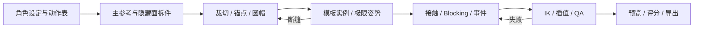

# 2D 骨骼动画历史调研

检索与验证日期为 2026-11-06。已核查工具官网、仓库、许可和版本记录。中英检索词覆盖 Spine 拆图、关节重叠、2D character cutout rig、ComfyUI split character、layered character diffusion、automatic 2D rigging 与 foot sliding。以下区分本机执行、格式探针、官方文档和未验证部分。供查找选型背景，当前生产方式以项目 README 和 Skill 为准。

## 推荐方案

本任务采用内置图像生成服务制作同板 Master 与拆件，使用 Pillow 裁切和打包，自有 JSON 骨架与解析 IK，浏览器 Canvas 运行时和无头 Pillow 验证。需要离线生产时，用本地 ComfyUI + Apache-2.0 FLUX.1-schnell 配合单色工作板与边缘去底，沿用拆件、绑骨和 QA。Godot 为游戏集成的开源选择，已实测骨架与动画采样。Spine 适合作为有人编辑复杂皮肤和约束时的候选，须按授权使用。见 [选型评分](../DECISIONS.md)。

## A · 骨骼动画与引擎

| 方案 | 能力与可编程性 | 许可、维护及判断 |
| --- | --- | --- |
| 自有 JSON + Canvas | 可生成、采样、导出图集；权重、二骨 IK、事件、附件、混合；浏览器和离线 Pillow。路径约束、通用编辑器需扩展。 | 4.50/5，实测。 |
| Godot 4 | Skeleton2D/Bone2D、Polygon2D 权重、2D 二骨 IK 修改器、AnimationPlayer；GDScript 和无头模式。全套 Web/桌面/移动构建依赖引擎。 | MIT，4.47/5。4.6.3 实测，版本档案另有 4.7。见 [Godot 实测](probes/godot/RESULTS.txt)。 |
| Spine | 网格、权重、IK、路径、蒙皮、约束、事件与换装；公开 JSON、CLI，Unity/Godot/Web/Cocos 等运行时。 | 4.40/5。专有编辑器与 Runtime License。仅读格式样例。见 [格式探针](probes/spine-result.json)。 |
| DragonBones | 骨架、插槽、网格、IK、换装和 JSON；Cocos 仍有 DragonBones API。 | JS runtime MIT（约 860 stars，仓库最后 push 2026-01-23），编辑器当前维护/发布条款未充分核实，优先作为旧资产兼容入口。[仓库](https://github.com/DragonBones/DragonBonesJS) |
| Spriter Pro | SCML/XML，部件插值、骨架、事件。 | 专有编辑器；查到 2012 的官方手册，现行 CLI 与版本更新未找到。[手册](https://www.brashmonkey.com/Spriter_manual.pdf) |
| Creature | 网格变形、骨骼、程序化运动与游戏导出；能和游戏工具链集成。 | 专有编辑器；目标平台的 runtime 仓库与授权分开核对，未做本地验证。[文档](https://kestrelmoon.com/creaturedocs/) |
| Live2D Cubism | ArtMesh、变形器、参数驱动，适合肖像、表情与软变形；可用于游戏，但多原型足接触仍需独立逻辑。 | Free/Pro 与 SDK 发行许可分别计算，Native/Web/Unity/Unreal/Cocos。[SDK 发行条件](https://www.live2d.com/en/sdk/license/) |
| Rive | 骨骼、权重、约束、网格和状态机，二进制 `.riv` 接运行时。 | C++ runtime MIT，约 1.25k stars，最后 push 2026-11-06。编辑器与导出有产品计划；本任务需要独立可编辑的 QA 数据。[功能](https://rive.app/features) · [运行时](https://github.com/rive-app/rive-runtime) |
| Moho | Smart Bones、矢量与网格变形、角色动画工具。 | 专有；官网提供 14.5。未验证面向 Web 的原骨架交换。[产品页](https://moho.lostmarble.com/products/moho-pro-14) |
| Toon Boom Harmony | 角色分层、变形器、绘画、摄像机，面向影视流程并提供游戏导出资料。 | 专有。流程复杂度高，未本测。[Harmony](https://www.toonboom.com/products/harmony) · [游戏工作流](https://cdn3.toonboom.com/wp-content/uploads/2023/03/07094241/TB_Harmony22-gaming_manual_v4.pdf) |
| Unity 2D Animation | Skinning Editor、SpriteSkin、2D IK、PSD Importer、动画控制器与 Editor Script。 | Unity 许可单独审核；13.0 分支在线文档显示 13.0.6（2026-08）。需要维护引擎项目和专有编辑器。[Animation](https://docs.unity3d.com/Packages/com.unity.2d.animation@13.0/manual/index.html) · [PSD Importer](https://docs.unity3d.com/Packages/com.unity.2d.psdimporter@12.0/manual/index.html) |
| Cocos Creator | 内置 Spine 和 DragonBones 组件、皮肤和附件交换、JS/TS 运行时。 | 适合集成现有数据，制作依赖外部编辑器；再分发取决于所用 runtime。[3.8 手册](https://docs.cocos.com/creator/3.8/manual/en/) · [DragonBones 3.8 API](https://docs.cocos.com/creator/3.8/api/en/class/dragonBones.CCSlot) |
| Blender + COA Tools | 正交相机、平面贴片、Armature 权重与 Python 可自动化。 | Blender 与原 COA Tools 均 GPL 系；原仓约 974 stars，最近 push 2024-05-02，不能假定新版 Blender 兼容。候选采用 Blender 原生平面/骨骼后另评导出。[原插件](https://github.com/ndee85/coa_tools) · [后续分支](https://github.com/Aodaruma/coa_tools2) |
| Inochi2D | 开源可变形木偶体系，可作为面部与软变形方向候选。 | BSD-2-Clause runtime，约 1.84k stars，最近 push 2026-10-03。需要另写足 IK 与逐帧检查适配。[源仓库](https://github.com/Inochi2D/inochi2d) |

## B · 生图、身份和分层

| 方案 | 适用性、可自动化、风险 |
| --- | --- |
| 内置图像生成 | 透明工作板 + 同板参考，六张均可拆。供应商未公开精确 checkpoint/seed。见 [生成清单](../../pipeline/gen/README.md)。 |
| FLUX.1-schnell | Apache-2.0 权重、4 步起点，有 ComfyUI 模板。RGB 工作板配纯色键。见 [官方模型](https://huggingface.co/black-forest-labs/FLUX.1-schnell)。[FLUX.1-dev 的权重协议不同](https://huggingface.co/black-forest-labs/FLUX.1-dev)。 |
| SDXL base | 有 LoRA、IP-Adapter、ControlNet 生态，默认 RGB。SDXL 1.0 权重 CreativeML Open RAIL++-M。先核具体衍生权重。[官方模型卡](https://huggingface.co/stabilityai/stable-diffusion-xl-base-1.0) |
| Qwen-Image / Edit / Layered | base 权重模型卡标 Apache-2.0，RGB 工作板用于文本设计，Edit 做局部补面，Layered 分解可编辑 RGBA。语义层未必等于完整骨段。见 [模型](https://huggingface.co/Qwen/Qwen-Image-Layered)。[base](https://huggingface.co/Qwen/Qwen-Image) |
| 闭源服务 | 可参考 Adobe Firefly、Gemini Image 做参考编辑和方案探索。产品计划与透明输出因具体入口而异。使用前核条款和 Alpha。[Adobe FAQ](https://helpx.adobe.com/firefly/get-set-up/learn-the-basics/adobe-firefly-faq.html) · [Gemini Image](https://ai.google.dev/gemini-api/docs/image-generation) |
| 身份与姿态 | 固定 Master/Prompt/种子作比较基线。IP-Adapter 保身份特征，ControlNet 的线稿/深度/姿势约束构图，LoRA 适合多套长期资产。种子不保证跨模型身份；非人形采用轮廓控制。模型与节点许可分别核对。[IP-Adapter](https://github.com/tencent-ailab/IP-Adapter) · [ControlNet](https://github.com/lllyasviel/ControlNet) · [LoRA 论文](https://arxiv.org/abs/2106.09685) |
| Pillow 规则切件 | 有 Alpha 工作板时最可控，坐标/锚点可版本化。没有隐藏面推理。见 [切件脚本](../../pipeline/split/prepare.py)。 |
| SAM / SAM2 | 点、框或视频提示的分割掩码，定位部位后仍需补画遮挡。SAM2 代码与权重 Apache-2.0 为主，具体依赖另审；约 20k stars。 [SAM](https://github.com/facebookresearch/segment-anything) · [SAM2](https://github.com/facebookresearch/sam2) |
| rembg / BiRefNet | 主体抠图/高分辨率前景边界，适合单件整体透明化；不用它决定关节归属。两仓库代码 MIT，模型可各有条款。 [rembg](https://github.com/danielgatis/rembg) · [BiRefNet](https://github.com/ZhengPeng7/BiRefNet) |
| LayerDiffuse | 在支持的扩散模型加入 alpha 生成/前后景分解，使用组合 checkpoint 核查模型条款。[作者仓库](https://github.com/layerdiffusion/LayerDiffuse) |
| ComfyUI 现成工作流 | 官方 FLUX 和 Qwen Layered 节点及工作流可程序化。第三方骨架图 → 图像/视频工作流可当参考，输出视频未保留骨长与可执行关节约束。未找到已实测可直接输出五原型 Spine 绑定的成熟工作流。[官方分层](https://docs.comfy.org/tutorials/image/qwen/qwen-image-layered) · [第三方工作流](https://github.com/mor-o/comfyui-2d-character-pipeline) |

## C · 辅助绑骨、动捕和新方法

- 模板、解析 IK 与姿势库已在五类原型运行。作者指定接触段，脚由目标反求，导出后按帧复检。见 [绑定规范](../spec/RIG_SPEC.md)。
- Meta Animated Drawings 使用图像、蒙版、关键点和动作适配，单张人形原画可获得快速动画。当前六足、膜片和规则约束继续用模板。见 [作者仓库](https://github.com/facebookresearch/AnimatedDrawings)。
- MediaPipe Pose Landmarker 提供图像/视频关节坐标，DWPose 提供全身 2D 姿态，OpenPose 提供人体骨点。按镜头做置信度滤波、世界相对角求取、展开、重新绑定，再修接触和关节。视频版权与姿态模型许可另审，OpenPose 对非商业研究与商业有不同许可。[MediaPipe](https://ai.google.dev/edge/mediapipe/solutions/vision/pose_landmarker) · [DWPose](https://github.com/IDEA-Research/DWPose) · [OpenPose](https://github.com/CMU-Perceptual-Computing-Lab/openpose)
- Adobe Character Animator 通过 PSD/AI 层命名和行为自动挂载，适合木偶表演。闭源产品，输出需另做游戏用 IK 适配。[自动绑定](https://helpx.adobe.com/in/adobe-character-animator/desktop/creating-and-controlling-puppets/prepare-artwork.html)
- 2025 年的 How to Train Your Dragon 用少量带 2D 骨点示例预测新姿态下的图像，覆盖多拓扑，不能直接推断其满足可编辑切片、支撑和循环 QA。PhysAnimator 提供物理引导的草图运动。2026 年 Bunraku 论文目标是从插画得到 Live2D 分层、网格和变形参数，当前只评论文。RigMo 用 3D 网格数据学习 rig 与 motion，和切片的输入输出不同。[Train Your Dragon](https://traindragondiffusion.github.io/) · [PhysAnimator](https://openaccess.thecvf.com/content/CVPR2025/html/Xie_PhysAnimator_Physics-Guided_Generative_Cartoon_Animation_CVPR_2025_paper.html) · [Bunraku](https://arxiv.org/abs/2607.27348) · [RigMo](https://openaccess.thecvf.com/content/CVPR2026/html/Zhang_RigMo_Unifying_Rig_and_Motion_Learning_for_Generative_Animation_CVPR_2026_paper.html)

## D · 制作实践

- 图层拆件和网格。官方 Photoshop 脚本可从层导出 PNG 和导入数据。先画完整隐藏轮廓，再在关节处留圆帽和压边，网格密度沿弯折区域加密，刚性武器用区域附件。皮肤与可装备物独立映射。[Photoshop 脚本](https://github.com/EsotericSoftware/spine-scripts/tree/master/photoshop) · [Spine 中文支持](https://www.spineapp.cn/support.html) · [Meshes](https://esotericsoftware.com/spine-meshes) · [Spine 商业项目展示与官方技巧](https://us.esotericsoftware.com/blog)
- 经典关键姿势采用接触、下降、经过、上升。先做主姿，逐级加延迟，最后用脚锁和接缝采样避免漂移。打击采用预备、快速命中、停顿、恢复。四足参考连续照片的落点分组，机械角色允许有依据的节奏改造。[Monmouth 动画教学](https://animation.monmouth.edu/instruct/animation/walk-cycle/) · [Lasseter，传统动画原则](https://dl.acm.org/doi/10.1145/37401.37407) · [美国国会图书馆 Muybridge](https://www.loc.gov/pictures/search/?q=animal%20locomotion%20muybridge)

## 风险与证据索引

- 许可证范围、未公开的生图模型 revision、各工具条款见 [授权](../RIGHTS.md)。工具许可证不替代对模型权重、样例纹理和目标发布渠道的审核。
- 主链样本 6 张图全部可切，并有局部裁切、亮度、锚点、旋转迭代。没有四种拆件策略的同图盲测；备选模型只做公开工作流/数据探针，无本地 GPU 推理质量结论。
- 复现证据集中在 [探针目录](probes/README.md)。版本与 stars 为核查时的快照，随仓库更新会变化。每条链接的访问日期为 2026-11-06。
