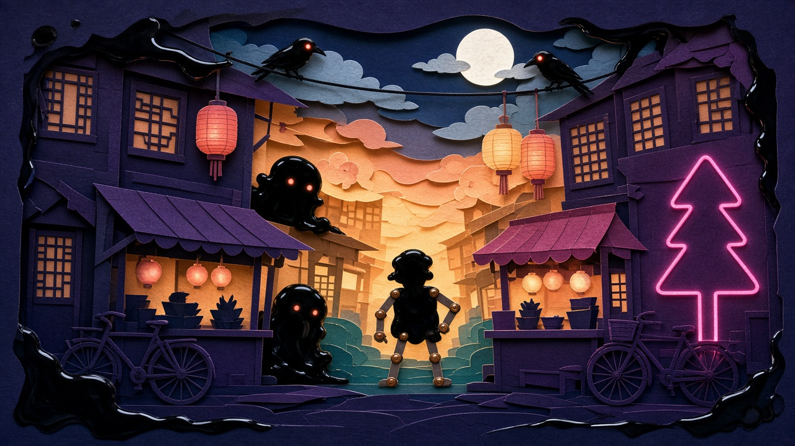
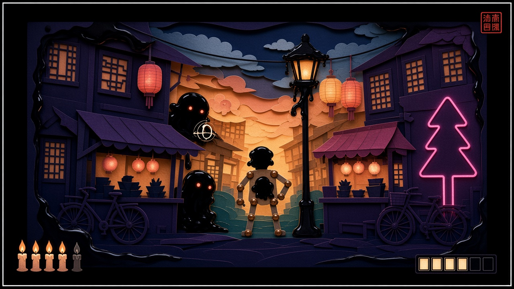
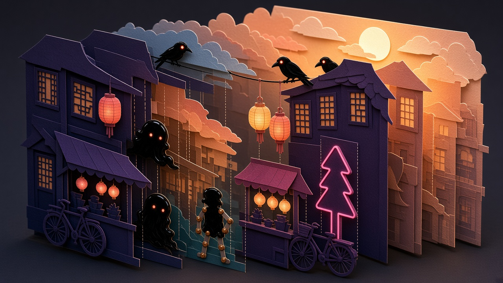
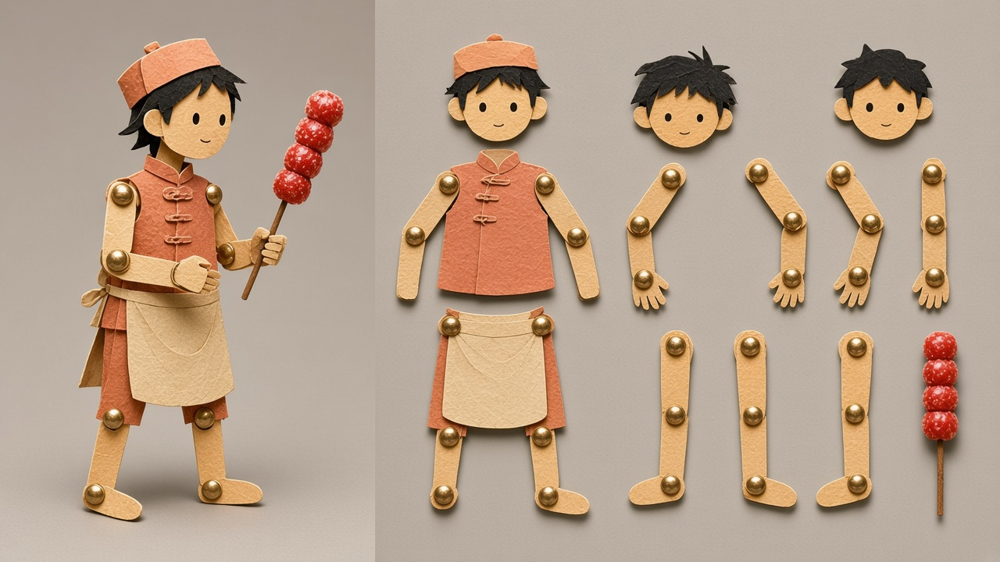
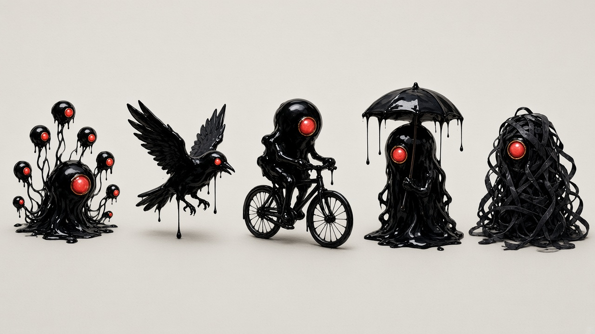
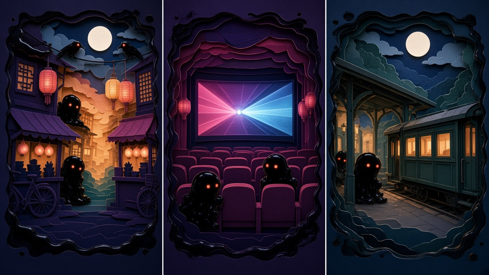
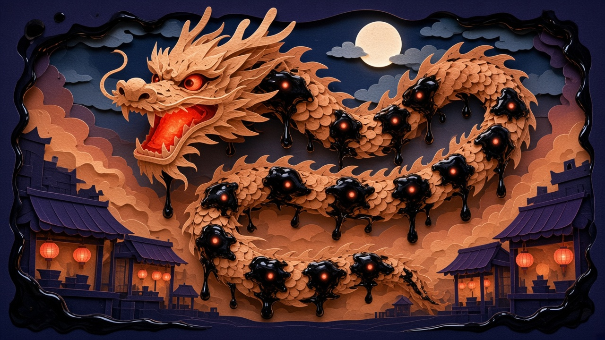
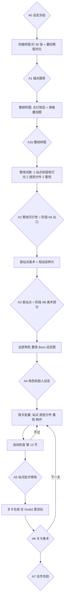

# 《纸灯城》美术风格与资产制作方案

> 2026-11-08 阅读说明：本文保留早期生产方案与决策依据，不代表功能均已实现。当前代码使用 Godot 4.6.3；Demo 与验收状态见 [项目入口](../README.md)。关卡设计引擎的新需求见 [关卡引擎方案](LEVEL_DESIGN_ENGINE_PLAN.md)（讨论稿）。 美术方向已确认，后续反馈与已批准的站点特例优先参照 [美术定稿](../gunforge/games/g01/bible/style.md) 及同目录契约。

> 版本 v0.3（2026-11-03）。状态：讨论稿，可以指导阶段 0A 的美术试做；全量生产的规范要等整帧样图（A1b）和首站点（A3）通过后再冻结。待你确认的项见第 17 节。
> 本文是《纸灯城》美术的详细依据：风格规范、资产清单、每类资产的制作步骤、检查点和输出格式。可执行的任务拆分见 [ART_TASKS_PAPER_LANTERN_CITY.md](ART_TASKS_PAPER_LANTERN_CITY.md)。
> 上游文档：世界观和玩法见 [GAME01_PAPER_LANTERN_CITY.md](GAME01_PAPER_LANTERN_CITY.md)；光枪硬约束（边框、亮度上限、命中区）和通用管线见 [GUNFORGE_PLAN.md](GUNFORGE_PLAN.md) 第 4、6 节。评审意见见 [REVIEW_ART_PLAN_PAPER_LANTERN_CITY.md](REVIEW_ART_PLAN_PAPER_LANTERN_CITY.md)，处理结果见第 18 节。
> 冲突时的优先级：GUNFORGE_PLAN 第 4 节的光枪硬约束 > 本文 > GAME01 第 4 节的风格摘要。

## 0. 单位和约定

- 除特别说明，尺寸都是**内容像素**。内容区 1776×936，和规范坐标 1:1（GUNFORGE_PLAN 第 3.2 节）。
- **源像素**指 AI 生成或处理时的图片像素，只在制作环节出现。每类资产都写明源像素和内容像素的换算。
- 亮度一律用 sRGB 编码亮度 Y′（0.299R + 0.587G + 0.114B），以白色为 100%。框架的亮度上限初始值是 75%（GUNFORGE_PLAN 第 4.3 节）。
- “AI”指管线里的生成模型、视觉模型和执行任务的 AI agent；“你”指审核人。
- 文中的阈值（色差 15、覆盖率 90%、风格分等）都是**初始值**，在 A2 用你通过和拒绝的样本标定后冻结（第 13.3 节）。

### 0.1 当前出图路径：直接 GPT

- 审核人已于 2026-11-03 指定图片生成、参考图生成、编辑、透明素材和标题字统一使用当前内置 GPT 图像生成工具，无需图像 API 密钥。Python 工具负责归档、组装、检查和数据处理。
- 一项独立资产或变体对应一次调用。透明素材明确请求真正透明背景，检查 alpha，拒绝伪透明棋盘格。编辑本地图片前先查看原图，并明确必须保留的构图、比例和角色特征。
- 不假定工具暴露具体模型、种子、任意尺寸、色板参数或结构化拆层。提示词给出比例、色板和用途；记录实际尺寸再归一化。参考图优先选 1–3 张最相关锚点，实际输入能力由 T01 验证。
- 拆层改为按白模逐层生成透明 PNG，或逐层提取并补全；层级、包围盒、遮罩、关节点由本地处理和视觉核对产生，不假装是生成工具的结构化返回。
- 每次调用先记本地尝试 ID；输出先复制到 `D:/gunforge_cache/g01/<任务编号>/`，记录提示词、参考哈希、实际输出路径及哈希、可取得的结果标识。未提供的模型/种子/任务 ID 记 null。结果未知时先核对已有输出，不盲目重发。
- 未披露的费用记 `amount: null, status: not_reported`，不得记成零或沿用旧供应商单价。按任务调用次数上限和重试上限管理用量；外部付费服务必须另行启用后才使用原现金预算闸门。
- 人工审核点继续生效。离线结果可预审，引擎检查保留待检查，T09–T16 等真实 0B 五项验收后再开始。内置工具不可用时不自动切换 API。

## 1. 效果图

下面 7 张是**方向效果图**，用 Cursor 内置的图像模型生成，只用来对齐风格方向，不进游戏，也不是锚点图。正式锚点图在阶段 0A 用内置 GPT 图像工具按第 5 节的流程生成，由你挑选。

每张图下面列出了它和规范不一致的地方，保留下来当反例。这些图都需要注释才能看懂哪些能用、哪些不能用，所以在 A1 之后还要补一张**接近可用的整帧**（第 1.9 节），证明规范能组合成好画面。

### 1.1 主视觉：第一关夜市



**要表达的：** 纸雕灯的层次（近处深色剪影掩体、中景台口、远处透光暖杏层），墨从画面边缘渗进来，墨怪躲在掩体后。这种由暗入亮的纵深是最值得保留的部分。

**偏差：**
- 月亮接近纯白（Y′ 接近 100%）。正式版换成暖色纸月，或者压到月白以下。
- 纸居民被画成了全黑，和墨分不开。正式版纸居民必须是亮色纸（第 2.9 节）。
- 墨怪有两只红眼。规则是每个墨怪只有一个朱砂弱点。
- 古式门窗和成排灯笼更像“古镇童话”，看不出 1990 年代。正式版按第 2.7 节放进年代物件，灯笼每个站点不超过 3 盏。
- 右侧霓虹是无意义的形状。正式版霓虹是镂空的字形，字作为独立素材单独出。

### 1.2 游戏内画面



**要表达的：** 光枪边框的结构（外黑边、纯白细边、厚黑暗区、内容区），以及 HUD 的大致位置：左下 5 根灯芯，右下 6 格光，右上朱砂印章，半透明的环形准星。

**偏差：**
- 右上印章里有乱码字。正式版印章框不带字，印文由引擎渲染（第 2.10 节）。
- 纸居民仍然偏黑；灯芯是写实蜡烛，正式版是剪纸风格。
- HUD 的实际占位超出了 60 像素的边缘带，正式版按第 2.10 节的保留矩形布局。

### 1.3 分层结构



**要表达的：** 一个站点是 6–10 张平面纸层前后叠放。实际资产里每层都是一张平面透明 PNG，深度感靠引擎里的视差系数做出来，不做真 3D。

### 1.4 纸居民分件



**要表达的：** 纸居民的造型（暖色纸、剪纸五官、圆形关节、铜扣）和“零件图”的样子。

**偏差：**
- 零件图里多画了一个头，上臂和躯干连在一起没拆开，围裙和裤子的拆法也不对。这正是第 7 节切件检查要拦下来的情况。
- 盘扣上衣偏古装。正式版服装用夹克、毛衣、的确良衬衫、围裙这类 1990 年代的日常轮廓（第 2.7 节）。

### 1.5 墨怪图鉴



**要表达的：** 墨的基本质感（纯黑、飞白边、滴落拉丝），以及一只墨怪一个朱砂弱点的读法。从左到右依次是墨蝌蚪群、墨鸦、墨车夫、墨伞、磁带墨。浅灰底是为了抠像，不是游戏画面。

**偏差：** 大面积镜面高光、圆润的体积和球状红核，让墨怪读起来像黑色树脂玩具镶红宝石。正式版减少高光，让流淌、拉丝、渗进纸纤维承担辨识；朱砂改成盖上去的印迹，不是球体（第 2.5 节）。

### 1.6 三关色调



**要表达的：** 第一关夜市以暖杏、桃粉为主，第二关旧影院以品红、冰蓝为主，第三关火车站以青绿、月白为主，一眼就能分出来。

**偏差：**
- 第一、第三格的月亮和第二格的银幕中心是纯白高光，会被亮度上限压平。
- 三格都是“居中亮洞、四周深色包围”的构图，换了颜色仍显得重复。三关的构图节奏见第 2.8 节。
- 列车偏精致的复古童话造型。正式版是方正的绿皮车厢加黄色腰线。

### 1.7 Boss：墨舞龙



**要表达的：** 纸龙被墨附身，每节龙身糊着墨团，龙嘴里是朱砂核。体量和纸龙鳞片有表现力，适合做视觉高潮。

**偏差：** 同屏墨团约 18 个，龙眼、张嘴发光和身上的目标同时抢注意力。正式版同屏可射的墨团不超过 6 个，龙眼不发红光，龙节分“当前可射、尚未开放、已净化”三态（第 9 节）。

### 1.8 效果图的亮度实测

按第 13 节检查 C03 的算法对整图统计（整图包含底色和边框，只说明方向图的问题，不代替素材检查）：

| 效果图 | Y′ 超过 75% 的像素 | Y′ 超过 90% 的像素 | 说明 |
|---|---|---|---|
| 主视觉 | 3.8% | 0.6% | 月亮和灯笼高光，超过 C03 的 2% 门限 |
| 分层结构 | 2.8% | 0.6% | 同上 |
| 三关色调 | 1.6% | 0.6% | 月亮和银幕中心 |
| 墨舞龙 | 1.4% | 0.2% | 月亮 |
| 游戏内画面 | 2.0% | 0.7% | 大部分是白边本身，白边不参与检查 |
| 纸居民设定、墨怪图鉴 | 8%、78% | — | 浅色底是为了抠像，抠完才检查 |

### 1.9 还缺的一张：整帧样图（A1b）

在 A1 锚点图选定后、A2 之前，用正式模型出一张**接近可用的整帧**，作为“规范能组合成好画面”的验证：

- 按内容区 1776×936 排布：一个夜市站点、一名附墨的亮纸居民、一只墨怪、一盏可射的灯、按第 2.10 节布局的真实 HUD。
- 同时出点灯前、点灯后两张。
- 另出一张叠加图：主可伤害区、弱点、保护区、HUD 保留矩形、60 像素边缘带都画出来，在实际显示尺寸下检查最小规格有没有冲突。

这张图不需要拆层，只要整体观感和规格叠加都能通过你的审核。

## 2. 风格规范

### 2.1 一句话和关键词

夜里点亮的多层纸雕灯：光从纸层之间透出来，墨从黑暗里渗进来。

三个关键词，所有提示词和审核都围绕它们：**透光纸层**、**湿墨**、**一点朱砂**。

### 2.2 深度带

每个站点分三个深度带，规则是**越近越暗、越远越透光**，亮度随深度单调变化。

| 深度带 | 纸层数 | 亮度 Y′ | 饱和度 | 细节 | 视差系数 | 用途 |
|---|---|---|---|---|---|---|
| 远景 | 2–3 | 45–75% | 中，本关主色 | 少：大块剪影、云纹、远处楼群 | 0.1–0.3 | 透光背景，给墨怪提供亮底 |
| 中景 | 2–4 | 25–55% | 中高 | 中：摊位、门窗、招牌、年代物件 | 0.4–0.7 | “台口”，敌人和居民出现的地方 |
| 近景 | 1–3 | 5–20% | 低，偏靛青、深紫 | 少：粗轮廓剪影，不做细镂空 | 0.8–1.0 | 掩体，挡子弹 |

三带合计 6–10 层。层数按站点的实际需要定，不为了凑数拆出没用的层；交互物件、灯光层和遮罩不计入这个层数（第 6.4 节）。

**可读性硬规则：** 墨怪（Y′ 约 4%）出现的槽位，紧贴它背后的那一层 Y′ 至少 25%。墨怪只从中景和远景前面冒出来，不能叠在近景的深色剪影上。

### 2.3 光

- **常驻背光：** 来自纸层后方的灯芯，暖色，从下往上略微变亮。只有这种光允许烘焙进站点图层。
- **交互光：** 可射的灯（路灯、灯笼、招牌）的发光和它照到周围的漏光**不烘焙**，单独做成灯光层和影响遮罩，由引擎按灯的状态叠加（第 6.4 节）。这样灯被墨遮住时，周围的光真的会暗下去。
- 每一层纸的边缘，背光那一侧有一线 2–4 像素的漏光，颜色取后面那一层的主色。这是纸雕灯观感的关键。
- 层与层之间有投影：向右下偏移 4–8 像素，不透明度 30–50%。
- 霓虹招牌是镂空字形透出彩光（品红、冰蓝），光晕半径不超过 24 像素。
- 内容区里不出现纯白。最亮的颜色是月白 `#B8C4D6`（Y′ 约 76%，会被亮度上限轻微压到 75%）。月亮、银幕、灯泡这类天然高光，一律画成暖色纸灯的透光，不画成白色光源。

### 2.4 色板和用量

色板沿用 GAME01 第 4.3 节。每一关按下面的比例控制面积：

| 关卡 | 夜底约 60% | 本关主色纸光约 30% | 点缀约 10% |
|---|---|---|---|
| 第一关 夜市 | 靛青、深紫 | 暖杏、桃粉 | 品红霓虹、青绿 |
| 第二关 旧影院 | 深紫、靛青 | 品红、冰蓝 | 暖杏 |
| 第三关 火车站 | 靛青 | 青绿、月白 | 暖杏车窗 |

朱砂 `#C8322C` 不计入上表：只用在弱点、印章和少量 UI 上，单个站点画面里的面积不超过 1%。背景、纸居民、道具都不能用接近朱砂的红，糖葫芦这类红色物件改成偏橙的暖红（色相和朱砂差 20° 以上）。

### 2.5 材质

| 材质 | 规定 |
|---|---|
| 纸 | 可见的纤维纹理（细，不抢轮廓）；切口干净，边缘有 1 像素的亮切面；纸面平整，不画褶皱和卷边 |
| 墨 | 墨黑 `#0B0B0E`。辨识主要靠**流淌、拉丝、渗进纸纤维的毛边、散成墨花**，不靠体积和反光。湿润高光只在朝光的一侧，面积不超过墨身的 5%，Y′ 不超过 60%，不沿整个轮廓勾亮边。墨和纸接触的地方要有渗进纸纤维的晕染 |
| 朱砂 | 像盖在墨上的一枚**印泥印迹**：平的，表面有印泥颗粒，边缘略不规则，外面一圈很薄的暖色光晕，不画成球体，也不加金属亮边。三种用法靠形状和运动区分：可伤害弱点是圆形印迹、会缓慢脉动；硬化状态只露一对细长的眼、裹灰墨壳、不脉动；UI 印章是方形，只在 HUD 区域 |
| 铜扣 | 纸居民关节上的铜色纸扣，尺寸见第 7.1 节，有一点金属高光 |

墨和朱砂的处理在 A1 用同一只墨怪做两版（高光多 / 高光少、红核 / 印迹），**放进真实的站点背景里**比较，不在浅灰底上选稿。

### 2.6 纹样和最小尺寸

- 窗户刻窗花，烟和云用云纹，水面用水波纹。
- 镂空细节只放在远景和中景的背景层上，可射的目标上不做细镂空。
- 最小刻线宽：和玩法有关的轮廓（目标、掩体边缘、可射物件）不小于 4 像素，装饰纹样不小于 3 像素。最小镂空孔不小于 6 像素。
  - 依据：27 寸显示器在 2.5 米处，1 内容像素约 0.31 毫米，3 像素约等于人眼 1.3 角分，已经接近分辨极限；55 寸电视上同样的 3 像素约 2.6 角分。
- 缩略图测试：整张画面缩到 1/8（222×117）转灰度，每个目标仍然认得出轮廓。

### 2.7 年代感和物件

年代感来自日常生活物件，不靠后期加“录像厅”几个字。每一关先定一组标志物件，统一转译成纸雕剪影，站点按需挑选：

| 关卡 | 标志物件 |
|---|---|
| 夜市 | 卷帘门、塑料凳和折叠桌、搪瓷杯、录像带盒和海报框、录音机、二八自行车、蜂窝煤炉、电线杆和高音喇叭、手写价目牌（字单独出） |
| 旧影院 | 售票窗口、木折叠座椅、胶片盘、放映机、手绘电影海报框、暖水瓶、玻璃汽水瓶 |
| 火车站 | 站台时钟、方正的绿皮车厢加黄色腰线、行李架、搪瓷缸、编织袋、检票口栏杆、候车室长椅、大字标语框（字单独出） |

纸居民的服装用 1990 年代的日常轮廓：夹克、毛衣、的确良衬衫、工作服、军绿外套、围裙、布鞋。不用盘扣、长衫这类古装元素。灯笼每个站点不超过 3 盏。

### 2.8 三关的构图节奏

前视平视不变，但三关的构图方式要分开，避免全部是“居中亮洞”：

| 关卡 | 构图节奏 | 标志构图 |
|---|---|---|
| 夜市 | 两侧摊位前后错落，横向交错；敌人从摊位之间横向穿出 | 巷口（两侧摊位夹出一条亮街）、天桥（横跨画面的桥身作中景） |
| 旧影院 | 纵向层级：前排座椅（近景）→ 银幕（中景）→ 放映窗（远景），光束形成对角线 | 观众席、银幕前 |
| 火车站 | 和画面平行的长线条：长月台、一排重复的车窗、连续的车厢，靠重复节奏取胜 | 站台、绿皮车厢 |

每关保留一两个标志构图，其他站点在玩法白模阶段主动变化构图。

### 2.9 角色和生物

**命中区和尺寸的统一规则**（和 GUNFORGE_PLAN 第 4.4 节一致）：

- **主可伤害区**：正常射击就能完成机制的区域（墨怪的墨身、居民身上的墨团、Boss 当前该打的部位、可射的灯）。它的**有效半径**在最小显示尺寸下不小于 40。有效半径的算法：先对区域做半径 12 的形态学开运算，去掉细尾巴、拉丝、飞白碎块，再把剩下的面积换算成等面积圆的半径。
- **弱点**：朱砂印迹，必须完全落在主可伤害区里面，打中有额外伤害或加分。它可以小于 40（直径 24–48），但**永远不能是唯一的解法**。
- 不允许出现“只有弱点能打”的墨怪。墨伞撑伞时伞面是无效区，收伞后墨身成为主可伤害区；硬化状态下墨身和眼睛都是无效区。

**纸居民：**
- 角色身份只允许人质或 NPC，人物本体是保护对象，不是敌人或怪兽；不设计攻击、投掷攻击或受伤死亡表现。附墨状态可净化的只有胸腹独立墨团。此规则来自项目负责人 2026-11-04 的明确反馈，优先于旧版的攻击动作描述。
- 用亮色纸做身体：暖杏、桃粉、青绿或月白，身体的 Y′ 不低于 35%。
- 侧身或四分之三侧身，头身比约 1:4.5，五官是剪纸式的简单线条，不画表情细节。
- 分件用 10 件人形模板加可选道具（第 7.1 节）。
- 显示高度：未附身的居民 220–512；**附墨状态的居民最小 300**。附身墨团只贴在胸腹（头太小，放不下有效半径 40 的墨团），墨团直径约 90–110，和纸身之间有一圈 6 像素以上看得出的边界；头、四肢、腿的纸身仍然露在外面。

**墨怪：**
- 外形由“吃掉的东西”决定，轮廓要在缩略图测试里认得出原物（鸟、自行车、伞……）。
- 每只墨怪只有一个朱砂弱点。成群的墨怪（墨蝌蚪）每只是一个单独的目标。
- 显示尺寸：普通墨怪 200–360；墨蝌蚪按**头部墨团**算，直径 90–130，尾巴不计入命中；`approach` 型走到近处最大 600。墨鸦这类细长造型，200 的最小显示尺寸下身体部分要够厚，过不了有效半径就提高它的最小显示尺寸。

**Boss：**
- 同屏可射的部位不超过 6 个，当前该打的部位满足主可伤害区的尺寸。
- Boss 由多个部件组成，每个部件按纸居民或墨怪的流程制作（第 9 节）。

### 2.10 UI 和 HUD 占位

| 元素 | 规格 |
|---|---|
| 生命 | 5 根剪纸灯芯，单个 36×64，间距 8，有“亮”和“灭”两态；左下角，离内容区边缘 24 |
| 弹药 | 6 格光，单格 32×48，间距 6，有“满”和“空”两态；右下角，离边缘 24 |
| 分数 | 朱砂印章，方形 112×112；右上角，离边缘 24。印章框由图像模型生成，**不带字**；印文由引擎用思源宋体 Heavy 加印章着色器渲染 |
| 提示 | 空弹、失锁（“请对准屏幕”）、回光提示，顶部居中横条 600×72 |
| 结算印章和面板 | 只在关卡结束、没有目标时出现 |
| 标题 | 毛笔字“纸灯城”，由图像模型单独生成成透明图层 |
| 正文、字幕 | 思源宋体 SemiBold，字幕 40、正文不小于 32；字色月白，衬一块 60% 不透明的深色底。**游玩中不出字幕**，旁白字幕只在过场和波次之间（没有目标时）出现 |
| 准星 | 半透明的纸环，直径 40，可在设置里关掉 |

HUD 的实际尺寸超出了 60 像素的边缘带，所以除了边缘带，再给每个常驻元素定一个**保留矩形**（元素外扩 16 像素），写进 `hud_layout.json`，玩法白模和槽位检查共同使用。目标的**整个运动包围盒**（包括 `approach` 走近时的放大）不能进入保留矩形。

| 保留矩形 | 内容坐标 [x, y, 宽, 高] | 何时生效 |
|---|---|---|
| 生命 | [8, 832, 244, 96] | 游玩中一直 |
| 弹药 | [1514, 848, 254, 80] | 游玩中一直 |
| 分数 | [1624, 8, 144, 144] | 游玩中一直 |
| 提示 | [572, 8, 632, 104] | 游玩中一直（提示随时可能出现） |
| 字幕 | [288, 776, 1200, 136] | 只在过场和波次之间 |

HUD 都在内容区里，不进入定位用的暗区。

### 2.11 禁止

写实渲染、3D 质感、塑料或树脂光泽、内容区里的纯白、大面积高亮、西式奇幻元素、古装和古镇童话元素、血腥恐怖、复杂到看不清轮廓的镂空、背景底图里的文字、接近朱砂的红色（弱点、印章以外）、黑色或深色的纸居民、球体或宝石状的朱砂核。

## 3. 资产清单

| 类别 | 内容 | 数量 |
|---|---|---|
| 站点 | 第一关：巷口、糖葫芦摊、录像厅门口、天桥、广场（墨舞龙）；第二关：售票处、海报长廊、观众席、放映室、银幕前（银幕影）；第三关：候车室、站台、绿皮车厢、灯座、工作台（“忘”字） | 15 |
| 过场专用场景 | 工作台全景、砚台特写、灯城全景（拉出纸灯的镜头） | 3 |
| 纸居民 | 卖糖葫芦的、录像厅老板、放映员、检票员、骑车的人，加 3 个通用路人 | 8 |
| 附身墨团 | 糊在纸居民胸腹的墨团形状，可通用 | 6 种形状 |
| 墨怪 | 墨蝌蚪、墨鸦、滴墨、墨车夫、墨招牌、磁带墨、墨伞；人物不归入敌人或怪兽 | 7 |
| Boss | 墨舞龙（龙头、龙尾、8 节龙身）、银幕影（巨影、3 个胶片盘）、“忘”字（7 笔） | 3 |
| 可射物件 | 路灯、灯笼、霓虹招牌、站台灯等，每关 3–4 种，每种带灯光层和影响遮罩 | 约 10 |
| 墨遮灯 | 爬上灯的墨的形状，可通用 | 3 种 |
| 道具 | 光（补弹）、灯芯（补命）、铜钱（加分） | 3 |
| 特效纹理 | 墨花溅射 6 种、光斑 2 种、纸屑 4 种；噪声纹理由程序生成 | 12 |
| UI | 灯芯、光格、印章框、标题字、关卡名字、按钮和面板框、准星、校准靶、调整画面边角 | 约 30 件 |
| 视频镜头 | 开场砚台翻倒、墨渗进灯里等 | 2–3 段 |

## 4. 总流程和检查点



| 检查点 | 时机 | 谁审 | 审什么 | 通过标准 | 不通过怎么办 |
|---|---|---|---|---|---|
| A0 设定冻结 | 开工前 | 你 | GAME01 第 6 节和本文第 17 节 | 你确认，或者给出修改 | 改设定后再确认 |
| A1 锚点图库 | 0A 第 1–2 天 | AI 预筛，你挑 | 约 30 张风格样图，加墨的两版对比（第 5 节） | 选出 6–12 张，站点、居民、墨怪、UI 四类各至少 1 张；每张标注它锚定什么；定下墨和朱砂的处理 | 改风格词重出一轮；两轮都不满意就回到 A0 调方向 |
| A1b 整帧样图 | A1 之后 | 你 | 第 1.9 节的整帧、点灯前后、规格叠加图 | 整体观感你认可；叠加图里没有尺寸冲突（主可伤害区、保护区边界、HUD 保留矩形） | 调规范或风格词后重出 |
| A2 管线可行性 | 0A 结束 | 自动检查 + 你 | 1 个站点的拆层和一盏灯的灯光，2 个不同体型和服装的纸居民的分件和动作，2 种墨怪（墨鸦、墨蝌蚪）的着色器效果；检查器的反例测试 | 站点拆出至少 6 个可用图层并通过 C07a、C07b；纸居民零件齐全率不低于 50%（4 次里至少 2 次）且全部程序化动作 C10 通过；墨怪着色器你认可；第 13.4 节的反例全部能让检查失败；内置模式 0A 不超过 120 次调用；外部付费模式才适用 300 元上限 | 换备选工具（第 15 节）；仍不行就降级方案（例如纸居民只做整体弹跳） |
| A3 首站点 | 0B | 自动检查 + 你试玩 | 第一个站点的完整美术，接上真实光枪；短动态样片（相机和呼吸组合运动、点灯前后、居民挣扎和获救、墨怪预警和消散、一次转场） | 适用的检查全部通过（第 13.2 节）；GUNFORGE_PLAN 第 13 节 0B 的五项标准里和美术有关的三项（判定可理解、素材可复用、成本可外推）通过 | 按问题回到对应步骤；有系统性问题就改本文规范再继续 |
| A4 角色和敌人设定 | 批量前 | 你 | 8 个纸居民、7 种墨怪、3 个 Boss 的设定图，并排放在审核画廊里 | 风格一致；每个角色符合第 2.9 节；你认可 | 单个重出；不影响已通过的 |
| A5 站点批次 | 每关的站点做完 | 自动检查后你看画廊 | 这一关的全部站点 | 站点适用的检查全部通过；你在画廊里逐张通过 | 拒绝的站点按你的备注重出，尝试编号加一 |
| A6 关卡美术 | 每关合成后 | 你试玩 | 这一关在 Godot 里的完整画面 | 整帧适用的检查通过；三关之间色调和构图分得清；L3 追踪实录合格 | 回到对应资产 |
| A7 全作冻结 | 三关做完 | 你 | 全作一致性、过场画面 | 你认可；manifest 冻结，构建只用已审核素材 | 回到对应资产 |

## 5. 风格锚定（A1）

1. **写风格词。** 按第 2 节写两段固定描述（第 14 节）：“材质与造型词”所有生成共用；“场景构图词”只用于站点和过场。
2. **出样图。** 约 30 张：站点 12 张（三关各 4 张，按第 2.8 节的构图节奏）、纸居民 6 张、墨怪 6 张、UI 6 张。统一由内置 GPT 生成，以提示词、锚点图和色板检查控制风格；探索稿与正式候选分别标记。
3. **墨的两版对比。** 同一只墨鸦出两版：A 版保留较多湿润高光和红核，B 版按第 2.5 节少高光、朱砂印迹。两版都合成进同一张站点样图里比较。
4. **AI 预筛。** 先跑 C03、C04、C05，把明显不合格的标出来（不删除），再按四类排进审核画廊。
5. **你挑锚点图。** 选 6–12 张，每张标注它锚定的是什么：光感、纸纹、墨质、构图、配色、年代物件中的一项或几项。
6. **写进设定。** 锚点图存进 `games/g01/bible/style_refs/`，标注写进 `anchors.json`；两段风格词、避免项和第 14 节的模板写进 `games/g01/bible/style.md`。
7. **之后怎么用。** 每次生成按用途从锚点图库挑子集作为参考图，优先选 1–3 张最相关锚点，给白模留位置；输入能力由 T01 验证，不沿用其他供应商上限。

花费：约 30 张正式样图加探索草图和墨的对比，工具未披露费用时记未知；T02 最多 36 次图像调用，0A 最多 120 次，含失败与重试。300 元保留为单独启用外部付费服务时的上限。

## 6. 站点背景

### 6.1 规格

| 项 | 值 |
|---|---|
| 内容区 | 1776×936 |
| 站点画布 | 1920×1020（内容区四周留视差余量：左右各 72，上下各 42） |
| 生成尺寸 | 目标源画布 2048×1088；按实际输出归一化，再 × 0.9375 转为画布像素。不假设工具支持精确请求尺寸 |
| 相机最大位移 | 水平 ±60，垂直 ±30 |
| 灯光呼吸漂移 | 水平 ±8，垂直 ±4，可以和相机位移叠加 |
| 层数 | 三带合计 6–10 层，见第 2.2 节 |

两种运动叠加后，前后两层的最大相对位移是：水平 (60 + 8) × 0.9 = 61.2，垂直 (30 + 4) × 0.9 = 30.6（0.9 是视差系数差的最大值 1.0 − 0.1）。画布余量 72 和 42 都够。

实际尺寸、透明性与编辑保真以 T01/0A 实测为准。manifest 记录请求尺寸、实际返回尺寸和归一化方法（缩放、裁切还是补边），不能假设返回的就是请求的尺寸。

### 6.2 制作步骤

1. **玩法白模图。** 按关卡 YAML 画一张 1776×936 的灰度白模：近景掩体的大致轮廓、敌人槽位和运动范围、可射物件和它的灯光范围、HUD 保留矩形和 60 像素边缘带（取自 `hud_layout.json`）。这张图作为构图参考输入，保证美术构图和玩法布局一致。三关的白模按第 2.8 节的构图节奏变化。
2. **构图草图。** 内置 GPT 图像工具，每个站点 4 张，提示词 = 材质与造型词 + 场景构图词 + 站点描述（第 14 节模板），参考图 = 白模图 + 2–3 张站点类锚点图。可射的灯在提示词里写成**熄灭**的（第 6.4 节）。
3. **选稿。** AI 按白模图的贴合度、C03、C04 打分，选 1 张；首个站点（A3）由你选。
4. **正式出图。** 内置 GPT 图像工具，请求 2048×1088，参考图 = 选中的草图 + 白模图 + 站点类锚点图，总共不超过 6 张。灯仍然是熄灭的。
5. **逐层制作。** 按白模和已选构图列出 6–10 个纸层，先出铺满画布的不透明底，再每次生成/编辑一层透明 PNG。提取时只保留指定层并补全被挡部分；明确统一画布、位置和不可改变的轮廓。灯独立制作。层级、包围盒由本地标注，不依赖结构化拆层 API。
6. **层整理。**
   - 按制作清单分进三个深度带，再核对与白模的遮挡关系；不一致时调整对应透明层。
   - 面积小于画布 0.5% 的碎层并进相邻的层；超过 10 层的合并到 10 层以内。灯、交互物件、灯光层和遮罩**不参与合并**。
   - 先保留完整源画布并对齐，再裁剪并计算包围盒、crop_origin；归一化后乘 0.9375 放到站点画布上。
   - 最远的一层必须是铺满整个画布的不透明底。
   - 给每一层画出**应有范围**遮罩 `<layer>_extent.png`：这张纸本来的完整形状，包括被前面层挡住的部分（例如墙面在摊位后面继续延伸）。视觉模型先画，人工抽查。
7. **补全被遮挡的部分。** 对每一层，需要补画的区域 = 应有范围 ∩（被更近的层挡住，但在某个运动状态下会露出来的区域）。“会露出来”按第 6.1 节的组合运动算：把前面各层的遮罩向各方向膨胀两层之间的相对位移（水平最大 61.2，垂直最大 30.6）。这一带用 GPT 透明图像编辑补画，提示词要求延续这一层的纹样。补画区域存成 `<layer>_fill.png`，供检查和返工定位。
8. **限亮和调色。** 逐层算 Y′ 分布，按第 2.2 节的范围做色阶调整；检查朱砂红是否出现在背景里（出现就改色）。
9. **灯光。** 按第 6.4 节做每盏灯的点亮版、灯光层和影响遮罩。
10. **标注。**
    - 敌人槽位：矩形、敌人缩放、出现方向、所在空间（敌人站在哪一层上，跟着那一层移动）、被哪些层挡住。视觉模型先标，再按白模图校正。
    - 可射物件：所在空间、命中区、对应的灯光。
    - 遮挡：每个近景层输出一张挡子弹遮罩 `<layer>_block.png`（alpha 大于 0.5 的部分），不能只写一个“挡子弹”的标记。
    - 安全带和 HUD 保留矩形：自动检查槽位的整个运动包围盒不进去。
11. **组装。** 输出 `station.json`（第 12.5 节）。用美术预览合成器（任务文档 T0）渲染：静止；相机在四个角的极限位置，叠加同方向和反方向的呼吸极值；转场在 0、25%、50%、75%、100% 五个时刻。
12. **自动检查。** 见第 13.2 节站点一行。

### 6.3 层的规则

- 每层是一张裁到包围盒的透明 PNG，处理顺序见第 12.1 节。
- 碰到画布边缘的层，必须延伸到画布边缘，不能在内容区里露出层的边界。
- 近景层（掩体）的轮廓线宽不小于 4 像素，形状简单，玩家一眼能看出“这后面能藏东西”。

### 6.4 交互灯光

“点灯”要求灯灭时周围真的变暗、灯亮时周围真的被照亮，所以可射的灯按下面的契约制作：

1. **底图里的灯是熄灭的。** 正式出图时可射的灯就画成熄灭状态（第 6.2 节第 2、4 步），站点图层里只有常驻背光。
2. **出点亮版。** 用内置 GPT 对正式图做编辑：“点亮这盏灯，暖光照亮周围的纸层，其他不变”。每盏灯单独出一张点亮版。
3. **算漏光遮罩。** 点亮版和熄灭版逐像素比较 Y′，差值（大于 0 的部分）经轻微模糊后存成这盏灯的影响遮罩 `lights/<lamp>_spill.png`（8 位灰度，线性数据，见第 12.1 节）。差值落在哪些层上，就把这些层记为受影响的层。
4. **灯光层。** 灯本身发光的部分（灯罩、灯泡的透光）从点亮版里抠出来，存成 `lights/<lamp>_glow.png`，叠加混合。
5. **墨遮灯。** 爬上灯的墨从通用的 3 种形状里选，贴在灯上，由着色器做蔓延和退去。
6. **引擎里怎么合成。** 受影响的层的颜色 = 原色 + 影响遮罩 × 灯光颜色 × 亮度；多盏灯的漏光相加，最后统一过亮度上限。灯的状态有熄灭、点亮、闪烁、被墨遮住四种，状态切换时亮度渐变（0.3 秒），没有生硬的矩形边。
7. **玩法上的灯光区域。** 点灯后哪些墨怪变软，由影响遮罩阈值 0.3 以上的范围决定，不再用矩形。

验收：播放“墨遮灯 → 射灯 → 区域变亮、墨怪变软 → 墨重新爬回”的完整过程，背景的光和敌人状态同步，边缘柔和；灯灭时仍能认出这盏要射的灯（灯罩轮廓和墨遮的形状清楚）。

这套做法（编辑出点亮版再求差值）在 0A 验证；不稳定时的备选是让模型直接画一张“只有光”的图层，或者由程序按灯的位置生成径向漏光。

## 7. 纸居民

### 7.1 规格

| 项 | 值 |
|---|---|
| 设定图 | 1024×1536 源像素，纯色中灰底 `#6E6A66`（和亮色纸、黑墨都拉得开，方便抠像） |
| 拼好后的高度 | 768 源像素；引擎里最大显示 512，只缩小不放大。显示下限见第 2.9 节 |
| 部件 | `humanoid_10` 模板 10 件，加 0–1 件日常手持道具；人物仅为人质或 NPC，不制作攻击用投掷物 |
| 衣物 | 帽子并入头；围裙、外套下摆并入躯干；裤腿并入大腿和小腿。衣物不单独成件 |
| 关节 | 圆形搭接，搭接圆半径不小于 32 源像素；铜扣直径 36–40 源像素，在搭接圆圆心 |
| 肢体宽度 | 不小于 72 源像素 |

尺寸换算：在 220 的最小显示高度下（缩放 0.286），搭接圆直径约 18 内容像素，铜扣约 11，肢体约 21；在 320 下铜扣约 16。铜扣不会盖住整个关节，肢体也满足 4 像素的最小线宽。

**部件清单只有一个来源：** `games/g01/bible/rigs/humanoid_10.yaml`。零件图提示词里的部件名、切件检查的期望数量、`puppet.json` 的父子关系都从这个文件生成，不手写。

```yaml
template: humanoid_10
parts:
  - { id: torso,       name: 躯干,   parent: null }
  - { id: head,        name: 头,     parent: torso }
  - { id: upper_arm_l, name: 左上臂, parent: torso }
  - { id: upper_arm_r, name: 右上臂, parent: torso }
  - { id: forearm_l,   name: 左前臂（含手）, parent: upper_arm_l }
  - { id: forearm_r,   name: 右前臂（含手）, parent: upper_arm_r }
  - { id: thigh_l,     name: 左大腿, parent: torso }
  - { id: thigh_r,     name: 右大腿, parent: torso }
  - { id: shin_l,      name: 左小腿（含脚）, parent: thigh_l }
  - { id: shin_r,      name: 右小腿（含脚）, parent: thigh_r }
optional:
  - { id: prop,      name: 手持道具, parent: forearm_r }
```

### 7.2 制作步骤

1. **设定图。** 内置 GPT 图像工具，中性姿势：四分之三侧身，手臂稍微离开身体，两腿分开，所有关节都看得见。服装按第 2.7 节。参考图 = 居民类锚点图。
2. **零件图。** 用同一个角色出“零件图”：所有部件在同一张真正透明画布上分开摆放，互不接触，间距至少 32 源像素。提示词里的部件列表由 `humanoid_10.yaml` 生成（10 件，加这个角色的可选件）。参考图 = 刚出的设定图。备选方案是参考设定图逐件生成透明部件，0A 两种都试，选成功率高的。
3. **切件。** 优先直接生成透明零件图并保留 alpha；需要修复底色时用 GPT 透明编辑或已验证的本地抠像，按连通区域得到**候选**块：面积小于图片 0.2% 的碎块（阴影、飞白、纸屑）不算部件，并到最近的块或丢弃并记录。视觉模型把候选块对上部件名称。对上之后的部件必须和清单完全一致，多一件、少一件、两件连在一起都算失败，尝试编号加一重出（效果图 1.4 就是失败的例子）。
4. **规格化。** 按设定图把所有部件缩放到拼好后高 768 源像素；用圆检测找铜扣，把圆心定为关节轴心；轴心找不到时由视觉模型标，再人工抽查。
5. **绑定。** 写 `puppet.json`（第 12.5 节）：父子关系、层级、轴心、挂点、静止角度、转动范围。
6. **动作测试。** 用美术预览合成器（任务文档 T0）按 `puppet.json` 播放全部程序化动作：探出、走、受惊、挥手呼救、受困挣扎、获救弹跳、感谢。纸居民只作为人质或 NPC，不制作攻击或投掷攻击动作。每个关节转到极限角度时截图，检查接缝（C10）。Godot 框架就绪后再在引擎里复测一次。
7. **附身墨团。** 墨团从通用的 6 种形状里选，贴在 `puppet.json` 里的胸腹挂点上，按第 2.9 节的尺寸。墨团是主可伤害区，纸身是保护区。
8. **记录成功率。** 分别记录零件齐全率、动作合格率、最终可用率，供成本估算用。A2 的 50% 只是试做门槛，不直接外推全部角色的成本。

## 8. 墨怪

### 8.1 规格

| 项 | 值 |
|---|---|
| 造型图 | 1024×1024 源像素；`approach` 型的墨怪 1536×1536（走近时会放大）。正式资产要求真正透明；审核设定图可用浅暖灰底 `#D8D2C8` |
| 显示尺寸 | 见第 2.9 节；源像素到显示只缩小不放大 |
| 输出 | 墨身 `body.png`、朱砂印迹 `core.png`、硬化状态的眼 `core_hardened.png`、距离场 `sdf.png`、`enemy.json` |

### 8.2 制作步骤

1. **造型图。** 内置 GPT 图像工具，中性姿态，墨和朱砂按 A1 定下的处理（第 2.5 节）。参考图 = 墨怪类锚点图。
2. **抠像。** 优先直接生成透明 PNG；保留飞白与渗墨半透明边缘。带底设定图才另行抠像，不能假设一定可靠，检查 C02。
3. **分离朱砂印迹。** 按颜色把朱砂色（和 `#C8322C` 的色差在阈值内）连同光晕分出来存成 `core.png`；墨身上原来被印迹盖住的地方用透明背景编辑补成墨，这样印迹可以单独脉动、单独隐藏（硬化状态）。
4. **硬化状态的眼。** 同一步骤再出一对细长的朱砂眼 `core_hardened.png`。
5. **距离场。** 从墨身 alpha 离线算有符号距离场，存成 `sdf.png`，编码见第 12.1 节。着色器用它做飞白边缘、蠕动位移、蒸发溶解。
6. **共同坐标。** `body`、`core`、`core_hardened`、`sdf` 共用这只墨怪的资产画布（未裁剪的 1024 或 1536 正方），各自裁剪后把裁剪原点写进 `enemy.json`（第 12.3 节）。
7. **着色器参数。** 每种墨怪一组预设：蠕动幅度和频率、滴落频率、高光强度、溶解时长。着色器对墨身做的位移，同样作用在印迹上，保证印迹始终在墨身上。
8. **状态。** 待机、预警、攻击、硬化、受击、蒸发，都由着色器和程序动画完成。硬化状态 = 在墨身上叠一层发灰的“墨壳”着色器，印迹换成细长的眼。
9. **复杂动作（少数）。** 着色器做不出的（例如墨鸦振翅），先用分件与程序动画；确需序列帧时用 GPT 出关键姿势、对齐后补间并检查循环。外部视频生成仅在审核人另行启用后使用，不属于 GPT 图片工具能力。序列帧按**最大显示尺寸**出（不是 1024 的源尺寸），先按第 12.6 节的预算算好帧数和尺寸再生成。

## 9. Boss

| Boss | 部件 | 制作要点 |
|---|---|---|
| 墨舞龙 | 龙头（上颚、下颚）、龙尾、8 节龙身，每节上一个墨团 | 以**分节链式绑定**为主，程序化做游动；视频循环只作降级方案，不同时做两套。每节有三态：**当前可射**（墨团脉动、暖光晕、对比最高）、**尚未开放**（墨团灰暗、不脉动、对比降低）、**已净化**（墨散去，龙节恢复暖纸色，微微发光）。同屏可射的不超过 6 节，按龙尾到龙头的顺序开放。龙眼是纸色，不发红光；只有最后阶段龙嘴里的朱砂核发光。先做一段 3 节龙身的“清墨后纸龙亮起来”样片，通过后再做整条龙 |
| 银幕影 | 巨大的墨影（画在银幕层上）、3 台放映机、3 个胶片盘 | 墨影是一张大图，用着色器做晃动和扭曲。放映机是正常光源，不可射；胶片盘上的墨渍是主可伤害区，净墨后放映机的光束从墨色渐变成暖光。要和第一关的“点灯”区分开（GAME01 第 5.4 节） |
| “忘”字 | 7 笔，每笔一层 | 见下文 |

**“忘”字的做法：** 结构先定、质感后加，不让模型自由写字再去切。

1. **笔画结构底稿。** 七笔按笔顺：亡（点、横、竖折）、心（点、卧钩、点、点）。用开源汉字笔画数据（例如 Make Me a Hanzi 的有序 SVG 笔画路径，接入前确认授权）取得七笔的轮廓，换算到 2048×2048 的画布，按毛笔字的气质调整粗细和笔锋，得到 7 张笔画遮罩。
2. **你确认遮罩**（任务文档里的停止点）。同时确认笔画交叉处谁在上面（后写的笔画在上）。
3. **加质感。** 墨的纹理、飞白、渗墨由墨着色器在每张遮罩上生成；需要更强的书法感时，可以把七笔合成后让模型做低强度的风格化，结果只保留遮罩以内的部分，再按遮罩切回 7 层。
4. **记录。** 每笔的笔顺号、交叉处层级、可射区域（扣掉被其他笔挡住的部分后，有效半径仍不小于 40）、散去后留下的淡灰残迹。
5. **三态。** 每笔有“待打”“当前”（脉动的朱砂描边，起笔处一个落笔光点）“已散”三态，由着色器完成。

验收：七层能完整合成“忘”字；逐笔隐藏时不会误删别的笔画；当前笔画在交叉处仍有足够的可射面积；按顺序打和打错都有明确反馈。

Boss 的设定图在 A4 一起审，部件做完后按第 13.2 节单独检查。

## 10. 可射物件、道具和特效

- **可射物件（灯、招牌）：** 按第 6.4 节制作。命中区是灯罩和发光部分，有效半径不小于 40。源图 512×512，显示 96–200 像素。
- **道具：** 光、灯芯、铜钱三种，源图 256×256，显示 90–112 像素（要容得下有效半径 40 的命中区），打中后有弹跳和闪光。
- **特效纹理：** 墨花溅射 6 种、纸屑 4 种由图像模型生成（纯色底，抠像），512×512；光斑 2 种和所有噪声纹理由程序生成。光束、墨烟、蒸发都是着色器和粒子，不生成视频。所有特效都在亮度上限之前渲染。

## 11. UI 和过场素材

**UI：**
1. 按第 2.10 节的清单，每件 UI 单独生成，纯色底，抠像。
2. 面板和按钮框做成九宫格：四角不拉伸，记录切线位置。
3. 标题毛笔字“纸灯城”和三个关卡名，用内置 GPT 单独生成成透明图层；生成后由你在 A4 确认字形。
4. 所有正文、数字、印文都由引擎渲染，不进图片。

**过场：**
- 过场场景和站点走同一套流程（第 6 节），但运镜幅度大，画布按镜头需要放大，例如 3072×1632 源像素。按实际输出归一化并检查细节与显存，不套用旧供应商的像素计价档。
- 特殊镜头默认用 GPT 生成场景层和关键帧，交引擎演出；离线视频只供预览。确需外部生成视频时另行启用，不作为出图前置；字幕由引擎渲染。

## 12. 输出格式规格

### 12.1 三类图片和例外

| 类别 | 用途 | 格式 | 色彩空间 | Godot 导入 | 着色器采样 |
|---|---|---|---|---|---|
| 色彩图 | 绝大多数素材 | PNG，RGBA 8 位，**非预乘 alpha** | sRGB | 见第 12.2 节 | 按颜色纹理采样 |
| 遮罩 | 应有范围、补画区、挡子弹、命中、灯光影响 | PNG，8 位灰度。硬遮罩只用 0 和 255；灯光影响遮罩用 0–255 | 线性数据，不是颜色 | 无损，不生成 mipmap | 不加 `source_color` |
| 距离场 | 墨怪、“忘”字笔画 | PNG，8 位灰度 | 线性数据，不是颜色 | 无损，不生成 mipmap，线性过滤 | 不加 `source_color` |

**距离场编码：** 像素值 v = clamp(128 + d × 127 / 32, 0, 255)，d 是到墨身边缘的距离（源像素），里面为正、外面为负，表示范围 ±32 源像素，零距离轮廓在 v ≈ 128。着色器按这个公式解码，不做 sRGB 转换。Godot 区分颜色纹理和数据纹理，数据纹理的 uniform 不能声明 `source_color`（[Godot 着色语言说明](https://docs.godotengine.org/en/4.7/tutorials/shaders/shader_reference/shading_language.html#using-source-color)）。

**色彩图的处理顺序：**
1. 抠像得到 alpha。
2. 裁到内容包围盒，四周留 8 像素透明边。
3. 把这 8 像素透明边里的 RGB 用最近的边缘颜色填满（alpha 不变），防止缩放滤波时出现底色边。
4. 图集里每帧之间留 8 像素间距，同样填色。
5. 导入时再打开 Godot 的 Fix Alpha Border 作为补充，不能代替上面几步。

**例外：**

| 文件 | 规定 |
|---|---|
| `preview.jpg`、`sheet.png` | 只给审核用，不进游戏构建，不过格式检查 |
| 标题字、关卡名字 | 色彩图，但允许带字（C05 反过来检查字形是否正确） |
| 字体 | 思源宋体 OTF，不是图片 |
| 视频 | Ogg Theora，见第 12.2 节 |

通用规则：文件名只用小写 ASCII、数字和下划线；不允许 JPG（审核预览除外）、16 位 PNG、索引色 PNG、烘焙进图片的文字（标题字除外）。

### 12.2 每类资产的规格

| 类别 | 源像素 | 显示（内容像素） | 文件 | Godot 导入（Forward+ / Compatibility） | 元数据 |
|---|---|---|---|---|---|
| 站点图层 | 请求 2048×1088，按包围盒裁剪 | 画布 1920×1020 | `layers/<band>_<nn>.png`，加 `_extent`、`_fill`、`_block` 遮罩 | VRAM 压缩高质量（BPTC）/ VRAM 压缩普通质量；不生成 mipmap | `station.json` |
| 灯光 | 同站点 | 同站点 | `lights/<lamp>_glow.png`、`lights/<lamp>_spill.png` | 灯光层同站点图层；影响遮罩见第 12.1 节 | `station.json` |
| 纸居民部件 | 拼好后高 768 | 220–512 | `parts/<part>.png` | 无损，生成 mipmap | `puppet.json` |
| 附身墨团 | 256×256 | 随居民缩放 | `ink_blobs/blob_<nn>.png` | 无损，mipmap | `puppet.json` 的挂点 |
| 墨怪 | 资产画布 1024 或 1536 正方，各文件裁剪 | 见第 2.9 节 | `body.png`、`core.png`、`core_hardened.png`、`sdf.png` | 色彩图无损加 mipmap；`sdf.png` 见第 12.1 节 | `enemy.json` |
| 序列帧 | 按最大显示尺寸出，每帧裁剪，15fps | 同墨怪 | `frames/atlas_<nn>.png` + `atlas.json` | VRAM 压缩（两种渲染器各配一份），不生成 mipmap | `atlas.json` |
| Boss 部件 | 按部件，同纸居民或墨怪 | — | 同上 | 同上 | `boss.json` |
| 可射物件 | 512×512 | 96–200 | `objects/<name>.png` | 无损，mipmap | `station.json` |
| 道具 | 256×256 | 90–112 | `<name>.png` | 无损 | `pickups.json` |
| 特效纹理 | 512×512 | 随粒子 | `fx/<name>.png` | 无损 | — |
| UI | 按显示尺寸的 2 倍出图 | 见第 2.10 节 | `ui/<name>.png`，九宫格另带切线 | 无损，不生成 mipmap | `ui.json`（九宫格切线、锚点） |
| HUD 布局 | — | — | `ui/hud_layout.json` | — | 第 2.10 节的保留矩形 |
| 字体 | — | — | 思源宋体 SemiBold、Heavy，OTF | 动态字体 | — |
| 视频 | 1776×936，30fps | 内容区 | `cutscenes/<name>.ogv`（Ogg Theora，ffmpeg `-q:v 7`），无音轨 | Godot 视频流 | 镜头表 |

渲染器在阶段 0B 定（GUNFORGE_PLAN 第 9 节），定之前两种导入配置都要备好。Compatibility 渲染器没有高质量的 BPTC 压缩，墨的飞白边缘在普通质量压缩下可能出现色块，0B 要实际比较（[Godot 图片导入说明](https://docs.godotengine.org/en/4.7/tutorials/assets_pipeline/importing_images.html)）。UI 按 2 倍出图，是为了 4K 电视上缩放后仍然清楚。视频如果编码器要求宽高对齐到 16，按 1776×944 编码，播放时裁掉下方 8 行。

### 12.3 坐标契约

只凭文件和元数据，就要能无歧义地组装出同一个对象。规则如下：

- **局部坐标：** 每个文件的像素坐标（裁剪后），原点在左上角。
- **资产画布：** 由多个文件组成、需要对齐的资产（墨怪的 body、core、sdf；站点的各层），共用一张未裁剪的资产画布，每个文件记录自己在资产画布里的裁剪原点 `crop_origin`。
- **纸偶部件：** 每个部件单独变换，`pivot`（轴心）和 `attach`（在父部件上的挂点）都用各自文件的局部坐标。
- **显示变换的顺序：** 局部坐标 → 减去轴心（或资产原点 `origin`）→ 乘显示缩放（源像素换成内容像素）→ 旋转 → 平移到父部件的挂点（父部件按同样顺序变换）→ 加所在空间的视差位移。
- **所在空间：** 站点里的槽位、可射物件、灯光、命中遮罩都写明 `space`：它属于哪一层，就跟着那一层的视差移动。敌人站在哪一层，就跟那一层；挡住它的层另外写在 `occluded_by`。
- **挡子弹的形状** 用遮罩文件，不用布尔标记。

验收：给一个资产随意多裁或少裁一圈透明边（同时更新 `crop_origin`），组装后的视觉位置和命中位置不变；相机移到极限时，灯、敌人、弱点和各自的命中区一起移动。

### 12.4 命名和目录

资产 ID 格式：`g01_<类别>_<名称>[_<变体>]`。类别缩写：`st` 站点、`res` 纸居民、`ink` 墨怪、`boss` Boss、`obj` 可射物件、`pick` 道具、`fx` 特效、`ui` 界面、`cut` 过场。例如 `g01_st_l1_01_alley`、`g01_res_hawthorn_vendor`、`g01_ink_crow`。

```
games/g01/bible/
  style.md  anchors.json  style_refs/
  rigs/humanoid_10.yaml
games/g01/assets/
  manifest.json
  stations/g01_st_l1_01_alley/
    station.json
    whitebox.png             玩法白模图，制作输入
    preview.jpg              预览图，只给审核用，不进游戏
    layers/far_00.png  far_00_extent.png  mid_00.png  mid_00_extent.png  mid_00_fill.png  near_00.png  near_00_block.png ...
    lights/lamp_01_glow.png  lamp_01_spill.png
    objects/lamp_01.png
  residents/g01_res_hawthorn_vendor/
    puppet.json
    sheet.png                设定图，只给审核用
    parts/head.png  torso.png  upper_arm_l.png  ...  prop.png
  ink_blobs/blob_00.png ...
  ink_on_lamp/cover_00.png ...
  ink/g01_ink_crow/
    enemy.json  body.png  core.png  core_hardened.png  sdf.png
    frames/atlas_00.png  atlas.json
  bosses/g01_boss_dragon/
    boss.json  parts/...
  pickups/  fx/  ui/  fonts/  cutscenes/
```

### 12.5 元数据示例

`station.json`（坐标是画布坐标，原点在画布左上角，内容区从 (72,42) 开始）：

```json
{
  "id": "g01_st_l1_01_alley",
  "canvas": [1920, 1020],
  "content_origin": [72, 42],
  "source_scale": 0.9375,
  "camera": { "max_shift": [60, 30], "breath": [8, 4] },
  "layers": [
    { "id": "far_00", "file": "layers/far_00.png", "band": "far", "z": 0, "pos": [0, 0], "size": [1920, 1020], "parallax": 0.1,
      "extent": "layers/far_00_extent.png" },
    { "id": "mid_00", "file": "layers/mid_00.png", "band": "mid", "z": 3, "pos": [212, 380], "size": [640, 420], "parallax": 0.5,
      "extent": "layers/mid_00_extent.png", "fill": "layers/mid_00_fill.png" },
    { "id": "near_00", "file": "layers/near_00.png", "band": "near", "z": 6, "pos": [0, 610], "size": [760, 410], "parallax": 0.9,
      "extent": "layers/near_00_extent.png", "block_mask": "layers/near_00_block.png" }
  ],
  "slots": [
    { "id": "s01", "space": "mid_00", "rect": [520, 400, 240, 300], "motion_bbox": [500, 360, 300, 360],
      "occluded_by": ["near_00"], "enter": "up", "scale": 0.8 }
  ],
  "shootables": [
    { "id": "lamp_01", "kind": "street_lamp", "space": "mid_00", "file": "objects/lamp_01.png", "pos": [1300, 220],
      "hit": { "shape": "circle", "r": 44 }, "light": "light_01" }
  ],
  "lights": [
    { "id": "light_01", "glow": "lights/lamp_01_glow.png", "spill": "lights/lamp_01_spill.png", "space": "mid_00",
      "affects": ["mid_00", "mid_01", "far_01"], "color": "#D9A066", "intensity": 0.8, "fade_s": 0.3,
      "soften_threshold": 0.3 }
  ]
}
```

`puppet.json`（`pivot` 和 `attach` 是各部件文件的局部坐标；实例的显示缩放由关卡数据给出）：

```json
{
  "id": "g01_res_hawthorn_vendor",
  "template": "humanoid_10",
  "assembled_height": 768,
  "origin": "feet_center",
  "parts": [
    { "id": "torso", "file": "parts/torso.png", "parent": null, "pivot": [96, 40], "z": 5, "rest_deg": 0 },
    { "id": "head", "file": "parts/head.png", "parent": "torso", "pivot": [70, 150], "attach": [96, 20], "z": 6, "limit_deg": [-20, 20] },
    { "id": "upper_arm_l", "file": "parts/upper_arm_l.png", "parent": "torso", "pivot": [40, 40], "attach": [40, 60], "z": 3, "limit_deg": [-150, 60] }
  ],
  "ink_anchors": [ { "id": "chest", "part": "torso", "pos": [96, 160], "blob_diameter_src": 260 } ],
  "hit_zones": [ { "type": "protected", "parts": "all", "from_alpha": 0.5 } ],
  "min_display_height": { "normal": 220, "possessed": 300 }
}
```

`enemy.json`：

```json
{
  "id": "g01_ink_crow",
  "asset_canvas": [1024, 1024],
  "origin": [512, 900],
  "files": {
    "body": { "file": "body.png", "crop_origin": [120, 200] },
    "core": { "file": "core.png", "crop_origin": [560, 380] },
    "core_hardened": { "file": "core_hardened.png", "crop_origin": [540, 390] },
    "sdf": { "file": "sdf.png", "crop_origin": [88, 168], "encoding": "v=128+d*127/32" }
  },
  "display_px": [240, 320],
  "hit_zones": [
    { "type": "primary", "from": "body", "alpha": 0.5, "min_effective_radius": 40 },
    { "type": "weak_point", "from": "core", "inside": "primary", "damage_mul": 2 }
  ],
  "shader": { "wobble_amp": 6, "wobble_hz": 0.8, "drip_rate": 0.3, "gloss": 0.3, "dissolve_s": 0.6 }
}
```

manifest 条目（字段含义见 GUNFORGE_PLAN 第 6.7 节）：

```json
{
  "id": "g01_ink_crow/body",
  "kind": "ink_body",
  "fingerprint": "sha256:…",
  "attempt": 2,
  "provider": "builtin_image_gen", "model": null, "task_id": null,
  "local_attempt_id": "g01_ink_crow_attempt_02", "tool_result_ref": "实际可取得的结果标识",
  "prompt_ref": "bible/style.md#material + design/bestiary.md#crow",
  "refs": ["sha256:…", "sha256:…"],
  "params": { "requested_size": "1024x1024", "returned_size": "1024x1024", "normalize": "none", "seed": null },
  "pipeline_version": "ink-v3",
  "checker_version": "art-checks-1",
  "cost": { "currency": null, "amount": null, "status": "not_reported" },
  "review": { "status": "approved", "by": "you", "note": "" },
  "checks": { "C01": "pass", "C02": "pass", "C03": "pass", "C10": "na:not_a_puppet", "C14": { "status": "pass", "score": 0.82 } }
}
```

### 12.6 序列帧和显存预算

**预算口径：** 下面是**资产纹理**的预算，按导入后的显存算，生成 mipmap 的纹理多算三分之一。渲染目标、后处理缓冲、字体缓存另外计量，不占这里的额度。同一纹理的多个实例只算一次。

| 部分 | 每个站点同时常驻的上限 |
|---|---|
| 站点图层和灯光 | 48 MB |
| 纸居民、墨怪、物件（含序列帧） | 32 MB |
| 特效、UI | 16 MB |
| 合计 | 96 MB |
| 站点转场时的峰值（两个站点同时在） | 160 MB |

**图集和序列帧：**
- 图集最大 2048×2048。一张满的 2048² 图集，无损 RGBA8 是 16 MiB，VRAM 压缩后约 4 MiB；4096² 的无损图集是 64 MiB，单张就超过角色预算，所以不用。
- 每段序列帧动画导入后不超过 8 MB。生成之前先算：帧数 × 每帧裁剪后的面积 × 每像素字节数。例：墨鸦振翅，最大显示 320，每帧裁剪后约 320×240，30 帧约 230 万像素，无损约 9.2 MB（超了），VRAM 压缩后约 2.3 MB（可以）。
- 站点图层参考：10 个图层平均裁剪后约 100 万像素，无损 RGBA8 约 40 MB，VRAM 压缩后约 10 MB。

验收：A3 用最重的同屏组合（最多的敌人种类加序列帧）和一次站点转场测峰值显存和帧时间。

## 13. 自动检查

### 13.1 检查定义

每项检查写明它检查的对象：**原始资产**（单个文件）、**组装体**（站点、纸偶、墨怪、Boss 组装后）或**整帧**（站点加敌人、灯光、特效、HUD 合成的游戏画面）。

| 编号 | 检查 | 对象 | 方法 | 通过标准（初始值） |
|---|---|---|---|---|
| C01 | 格式和规格 | 原始资产 | 读文件头和元数据，按第 12.1 节的类别 | 色彩图、遮罩、距离场各自符合格式；尺寸、命名、目录正确 |
| C02 | 透明边缘 | 原始资产（色彩图） | 叠在黑底和白底上比较半透明边缘 | 半透明像素里残留生成底色的不超过 1%；透明边已按第 12.1 节填色 |
| C03 | 亮度 | 原始资产 + 整帧 | 只统计 alpha ≥ 0.5 的像素，按 alpha 加权；站点按深度带统计；整帧包含灯光和特效 | 整帧里被亮度上限压掉的像素不超过 2%；各深度带落在第 2.2 节范围内 |
| C04 | 色板 | 原始资产（色彩图） | alpha ≥ 0.5 的像素按 alpha 加权，排除朱砂和灯光层，算到最近色板颜色的色差（CIEDE2000） | 90% 的像素色差不超过 15；朱砂色只出现在允许的资产里，站点中面积不超过 1% |
| C05 | 文字 | 原始资产 | 文字识别（OCR） | 背景、角色、墨怪、物件、UI 框：检测不到文字。标题字和关卡名：识别结果必须是预定的字 |
| C06 | 可读性 | 整帧，按状态 | 普通态：目标和背后那一层的 Y′ 差；硬化态：眼和周围的 Y′ 差；预警态：视觉模型判断预警是否看得出；1/8 缩略图测试 | 普通态 Y′ 差不小于 20%；硬化态眼的 Y′ 差不小于 30%、眼长不小于 16；预警态看得出；缩略图认得出轮廓 |
| C07a | 全屏覆盖 | 组装体（站点） | 第 6.2 节第 11 步的全部运动状态渲染 | 内容区每个像素都被不透明的层覆盖 |
| C07b | 分层暴露 | 组装体（站点） | 同样的运动状态下，对每一层：在它的应有范围里、当前可见的像素，这一层自己必须不透明；输出每层的诊断图 | 没有一处“该是这层却露出了后面的层” |
| C08 | 遮挡一致 | 组装体（站点） | 对比挡子弹遮罩和近景层的可见部分 | 两者重合；藏在掩体后的槽位确实被挡住 |
| C09 | 命中区 | 组装体 + 整帧 | 在最小显示尺寸下按第 2.9 节算有效半径；叠加 HUD 保留矩形和边缘带 | 主可伤害区有效半径不小于 40；弱点在主可伤害区里面；不和保护区重叠；运动包围盒不进入边缘带和保留矩形 |
| C10 | 纸偶 | 组装体（纸居民、Boss 部件） | 部件和 `humanoid_10.yaml` 比对；每个关节转到极限角度渲染 | 部件清单一致；关节处没有超过 2 像素的缝；铜扣不盖住整个关节 |
| C11 | 对齐 | 组装体 | 着色器各状态、序列帧每一帧、相机极限位置下，检查弱点、命中区和视觉的位置 | 弱点始终在墨身可见部分上；命中区跟着视觉走 |
| C12 | 循环 | 原始资产（序列帧） | 比较首尾帧和首尾运动速度 | 首尾帧平均像素差和速度差在阈值内，看不出跳变 |
| C13 | 追踪合规 | 整帧 | GUNFORGE_PLAN 第 10 节的 L3 截图筛查 | 边不被拒收，中空校验通过 |
| C14 | 风格评分 | 原始资产 + 整帧 | 视觉模型对照锚点图打分，同时输出理由 | 分数不低于阈值 |
| C15 | 显存 | 组装体 + 整帧 | 导入后统计 | 符合第 12.6 节的预算 |
| C16 | 数据纹理 | 原始资产（遮罩、距离场） | 距离场解码后的零轮廓和 alpha 0.5 轮廓比较 | 两条轮廓相差不超过 1 源像素；数据纹理没有被当成颜色处理 |

### 13.2 按资产类型适用的检查

| 资产类型 | 原始资产 | 组装体 | 整帧 |
|---|---|---|---|
| 站点 | C01–C05、C14、C16（遮罩） | C07a、C07b、C08、C11、C15 | C03、C06、C09、C13、C14 |
| 纸居民 | C01–C05、C14 | C09–C11、C15 | C06、C09 |
| 墨怪 | C01–C05、C12（序列帧）、C14、C16 | C09、C11、C15 | C06、C09、C13 |
| Boss | 同纸居民或墨怪 | C09–C11、C15 | C06、C09、C13 |
| 可射物件、道具 | C01–C05、C14 | C09、C11 | C06、C09 |
| 特效纹理 | C01、C02 | — | C03、C13 |
| UI | C01、C02、C05 | — | C03、C09（保留矩形） |
| 标题字、关卡名 | C01、C02、C05（反向） | — | — |
| 字体、视频 | 只查文件规格 | — | C03（视频抽帧） |

整帧检查要覆盖这些状态：正常游玩、空弹提示、失锁提示、点灯前后、波次之间出字幕。

### 13.3 结果状态和阈值标定

- 每项检查的结果是**通过、失败、待检查、不适用**四种之一。“不适用”要写原因；没运行就是“待检查”，**永远不会自动变成通过**。
- 离线预审允许引擎项目保留待检查；正式 A3/0B、A5、A7 必须完成全部适用检查。离线通过不能自动转成引擎通过。
- 阈值是初始值。A2 时用你在 A1、A2 通过和拒绝的样本（每类至少 20 张）标定，标定后冻结检查器版本，写进 manifest 的 `checker_version`。
- OCR 和视觉模型的检查要输出证据（截图、框出的位置、理由）。这两类检查失败时只自动重试 1 次，再失败就交给你判断，不无限重出。
- 风格评分 C14 不够时，同一素材最多自动重试 2 次，之后交给你。

### 13.4 用反例验证检查器

A2 之前，每项检查都要能被对应的反例弄失败，否则说明检查器没起作用：

| 反例 | 应该失败的检查 |
|---|---|
| 删掉中景被近景挡住的一块纹样 | C07b |
| 把墨怪的弱点挪到墨身外面 | C09、C11 |
| 让一个槽位的运动包围盒压住生命 HUD | C09 |
| 把距离场按颜色纹理导入或加 sRGB 转换 | C16 |
| 用一张 4096² 的无损序列帧图集 | C15 |
| 在背景里放一行字 | C05 |
| 零件图多一个头 | C10 |

## 14. 提示词模板

GPT 使用中文提示词，明确参考图角色、构图和必须保留的细节。下面是骨架，具体措辞在 A1 时按样图效果调整，定稿后写进 `style.md`。如果模型没有单独的反向提示词参数，“避免”一段就写在提示词末尾。

**材质与造型词（所有生成共用）：**

> 手工刻纸风格。平面的纸，可见细纤维纹理，切口干净，边缘有一线亮切面。造型简洁、轮廓清楚。墨是纯黑的液态墨，靠流淌、拉丝、渗进纸纤维的毛边来表现，只有少量湿润高光。朱砂是盖在墨上的一枚平的印泥印迹。1990 年代中国小城的日常生活物件。

**场景构图词（只用于站点和过场）：**

> 多层纸雕灯，夜里点亮的灯箱。若干层平面刻纸前后叠放，背后有暖色灯芯光，光从纸层之间透出，每层边缘有一线漏光和淡淡投影。近处的纸层是深靛青、深紫色剪影，越远的纸层越透光。整体偏暗、高对比，温暖、带一点诡丽。正面平视，不做大角度透视。

**站点：**

> {材质与造型词} {场景构图词} 场景：{站点描述，如“1990 年代中国小城夜市的巷口：两侧是卷帘门和摊位，塑料凳和折叠桌，二八自行车，电线杆和高音喇叭”}。构图按参考白模图：{近景掩体位置}是近处深色剪影，{中景}是摊位和门窗组成的台口，远处是透光的{本关主色}楼群和云纹。{可射的灯的位置}的灯是熄灭的。画面里没有人物和怪物。
> 避免：纯白、大面积高亮、文字和字母、写实渲染、3D 质感、塑料光泽、古装和古镇元素、超过 3 盏灯笼、复杂到看不清的镂空。

**纸居民设定图：**

> {材质与造型词} 角色设定图：一个平面纸偶，{身份}，穿{1990 年代日常服装，如“灰蓝色夹克和围裙”}，用{暖杏 / 桃粉 / 青绿}色的纸做成，剪纸式的简单五官。四分之三侧身，中性站姿，手臂稍微离开身体，两腿分开。关节处是圆形搭接，钉铜色纸扣。纯色中灰底，均匀柔光。
> 避免：黑色或深色的身体、朱砂红、盘扣和古装、文字、阴影、背景杂物。

**纸居民零件图：**

> 和参考图同一个角色的零件图：把{由 humanoid_10.yaml 生成的部件列表}共 {N} 个部件分开平铺在真正透明画布上，不画棋盘格或底色，互不接触，间距均匀。帽子画在头上，围裙画在躯干上，不单独成件。每个部件在关节处是圆形的端头。每个部件只出现一次。

**墨怪：**

> {材质与造型词} 墨怪设定图：{吃掉的东西}被墨吞掉后变成的生物，{外形描述}。纯黑的液态墨，边缘有飞白和渗墨，有滴落和拉丝，只在朝光的一侧有一点湿润高光。身上只有一枚圆形的朱砂印迹，平的，有印泥颗粒，外面一圈很薄的暖色光晕。轮廓清楚，缩小了也认得出是{原物}。正式独立素材使用真正透明背景，不画棋盘格；审核设定图可用浅暖灰底。
> 避免：多个红点、球体或宝石状的红核、大面积反光、树脂或橡胶质感、其他颜色、写实恐怖、血腥、文字。

## 15. 风险和降级方案

| 风险 | 降级方案 |
|---|---|
| 拆层切错层、漏层 | 按白模逐层生成；提取失败重出该层，并验证对齐和 C07a/b |
| 补全的内容和原层纹样接不上 | 加大补画范围，或者减小这个站点的最大相机位移 |
| 点亮版编辑改动了灯以外的内容 | 差值只在灯周围的限定范围里取；仍不行就用程序生成径向漏光 |
| 零件图切件反复失败 | 对设定图做图层拆分；再不行这个角色只做整体弹跳和翻转，不做关节动作 |
| 墨着色器不好看 | 优先分件和 GPT 关键姿势；外部视频另行启用，按第 12.6 节预算 |
| 风格漂移 | 收紧锚点子集；统一后处理；必要时用已审核素材训练 LoRA |
| 色板跑偏 | 提示词指定色板并带锚点；C04 检查后局部调色或重出 |
| 生成图里出现文字 | C05 拒收；提示词加“避免文字”；背景只保留镂空形状，字单独出 |
| 亮度超限 | 高光改成暖色纸灯透光；C03 超过 2% 就重出，而不是靠亮度上限硬压 |
| 显存超预算 | 先降序列帧尺寸和帧数，再改用 VRAM 压缩；不在最后一步才发现 |

## 16. 和其他文档的衔接

- GUNFORGE_PLAN 第 6 节是通用的美术管线概要，本文是它在《纸灯城》上的展开；以后做第二款游戏，照本文的结构另写一份。
- GAME01 第 4 节保留风格摘要，细节以本文为准。
- 本文的检查点 A1、A4 分别对应 GUNFORGE_PLAN 第 12 节的审核点 1、3；A2 是阶段 0A 的出口，A3 是阶段 0B 的美术部分。
- AI agent 按 [ART_TASKS_PAPER_LANTERN_CITY.md](ART_TASKS_PAPER_LANTERN_CITY.md) 执行，任务文档只拆分步骤，规格以本文为准。

## 17. 待你确认

| 项 | 当前方案 |
|---|---|
| 效果图方向 | 第 1 节的 7 张，偏差已标出；整体方向是否认可 |
| 纸居民用亮色纸 | 身体 Y′ 不低于 35%，不用深色纸（第 2.9 节） |
| 墨和朱砂的处理 | 少高光、靠流淌和渗墨辨识；朱砂是平的印迹，不是红宝石（第 2.5 节），A1 用两版对比最终定 |
| 年代感 | 按第 2.7 节的物件清单；服装用夹克、毛衣、围裙，不用古装 |
| 附墨居民 | 墨团只贴胸腹；附墨状态最小显示高度 300（第 2.9 节） |
| 游玩中不出字幕 | 旁白字幕只在过场和波次之间（第 2.10 节） |
| 月亮、银幕这类高光 | 一律画成暖色纸灯透光，不画白色光源（第 2.3 节） |
| 印章不带字 | 印章框生成，印文由引擎渲染（第 2.10 节） |
| 站点画布 | 1920×1020，相机最大位移 ±60、±30，可叠加呼吸 ±8、±4（第 6.1 节） |
| Boss 同屏可射部位 | 不超过 6 个；墨舞龙以分节绑定为主（第 9 节） |
| “忘”字 | 先定七笔遮罩、你确认，再加质感（第 9 节） |

任何一项想改，直接说改哪里。

## 18. 修改记录

### v0.2 → v0.3（2026-11-03，直接 GPT 出图）

按审核人要求统一采用内置 GPT 出图与编辑，取消图像 API 密钥前置；逐层透明素材替代结构化拆层，色板改为提示词和检查控制；费用未知不记零，增加调用次数限制。真实 0B 批量门槛继续生效。


### v0.1 到 v0.2（按 [评审意见](REVIEW_ART_PLAN_PAPER_LANTERN_CITY.md) 修改）

评审的规格计算都复核过，属实：纸偶部件按名称数是 10 件；弱点直径 24–48 和上游“可伤害区半径至少 40”冲突；灯芯 24 + 64 = 88 超出 60 像素边缘带；4096² 的 RGBA8 图集是 64 MiB；呼吸叠加后的相对位移是 61.2。全部意见采纳。

| 评审项 | 修改 |
|---|---|
| AR01 部件数 | 改为 `humanoid_10` 加可选道具；衣物并入所属部件；部件清单只来自 `humanoid_10.yaml`；连通区域只作候选（第 7 节） |
| AR02 弱点尺寸 | 区分主可伤害区（有效半径 ≥ 40，带形态学开运算的算法）和弱点（奖励，可以小）；附墨居民墨团只贴胸腹，附墨状态最小 300；墨蝌蚪按头部墨团算（第 2.9 节）；上游 GUNFORGE_PLAN 第 4.4 节同步修改 |
| AR03 HUD 占位 | 新增 HUD 保留矩形和 `hud_layout.json`；游玩中不出字幕；目标的运动包围盒不进入保留矩形（第 2.10 节） |
| AR04 露洞检查 | C07 拆成全屏覆盖 C07a 和分层暴露 C07b；每层加应有范围和补画区遮罩；补画范围计入呼吸叠加；测试状态改为角点加呼吸极值加转场五个时刻（第 6 节） |
| AR05 检查适用范围 | 检查写明对象（原始资产、组装体、整帧）；新增按资产类型的适用表；结果分四种状态，没运行不算通过；C03、C04 按 alpha 加权；C06 按状态（第 13 节） |
| AR06 数据纹理 | 图片分成色彩图、遮罩、距离场三类；写明距离场编码和采样规则；新增 C16（第 12.1 节） |
| AR07 坐标 | 新增坐标契约：资产画布、裁剪原点、变换顺序、所在空间；示例补全字段；挡子弹改用遮罩文件（第 12.3、12.5 节） |
| AR08 点灯光照 | 新增交互灯光契约：底图灯熄灭，编辑出点亮版求漏光遮罩，灯光层单独叠加；灯光区域改用遮罩；交互层不参与碎层合并（第 6.4 节） |
| AR09 显存 | 图集上限改为 2048²；序列帧按最大显示尺寸出、先算预算再生成；两种渲染器各配导入；预算只算资产纹理，另定转场峰值（第 12.6 节） |
| AR10 “忘”字 | 改为先定七笔遮罩并由你确认，再加质感；记录交叉层级和每笔可射面积（第 9 节） |
| 视觉意见 | 新增年代物件和服装（第 2.7 节）、三关构图节奏（第 2.8 节）；墨少高光、朱砂改印迹，A1 在真实背景里两版对比（第 2.5 节）；墨舞龙三态（第 9 节）；新增 A1b 整帧样图（第 1.9 节） |
| 细节 | 层数总量约束；先裁剪留 8 像素再填色、图集间距 8；铜扣和搭接圆按源像素重定；manifest 记请求和返回尺寸；C05 按类别区分；墨舞龙以绑定为主；风格词拆成两段；阈值用样本标定；成功率分三项记录 |


### A2e 已批准的首站点亮度例外（2026-11-05）

仅适用于 `g01_st_l1_01_alley` 试做，版本 `g01-alley-luminance-exception-1`。审核人明确同意保留已认可夜景，将整层均值转为诊断，原C03结果保留；各可射槽位仍须在相机/点灯/运动状态满足：背底Y′≥0.25、普通目标差≥0.20、硬化眼与墨身差≥0.30、单眼≥16像素。近景范围及整帧限亮规则保留。其他站点仍按第2.2节；本例外不批准A2技术项、正式生产或真实0B。机器可读规范见 `gunforge/games/g01/bible/luminance_policy.json`。硬化墨鸦采用已审核的暖纸色眼材质，原始贴图与普通态保留。
