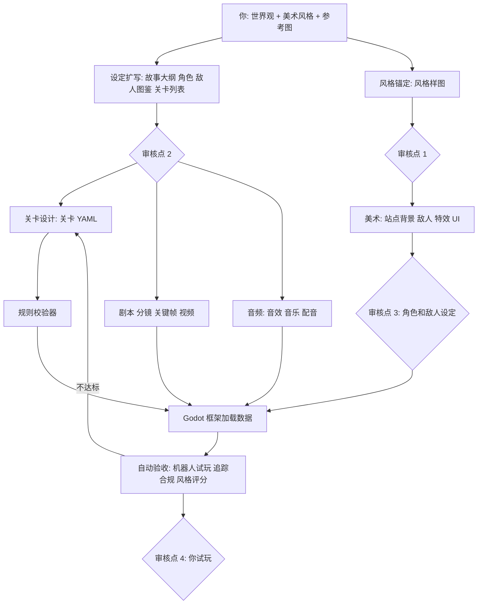

# GunForge：AI 光枪游戏工厂方案

> 版本 v0.4（2026-11-02）。状态：讨论稿，尚未开工。
> 游戏工厂放在本仓库的 `gunforge/` 子目录。枪本身（手机光枪）见 [HANDOVER.md](../HANDOVER.md)。
> 首款游戏设定见 [GAME01_PAPER_LANTERN_CITY.md](GAME01_PAPER_LANTERN_CITY.md)。
> 第 17 节是决策清单，全部已定；首款设定细节待你确认。

## 0. 已确定的前提

| 项 | 结论 |
|---|---|
| 游戏类型 | 只做光枪游戏 |
| 玩家 | 自己和朋友在家玩，不商业发行 |
| 首款形态 | 分镜式（定点站位，敌人从掩体后出现），全 3D 轨道以后再说 |
| AI 服务 | 国内模型优先，海外模型作为备选 |
| 美术大方向 | 第一版只做 2D；美术是最重要的部分，先单独验证（阶段 0A） |
| 分工 | 首款的世界观、风格和玩法由 AI 提出、你来定；其余全部由 AI 完成，你只在审核点介入 |

不做：多人联网、移动端、商业发行、上架合规。

## 1. 总体思路

1. **框架写一次，游戏只是数据。** 先用 AI 写一个通用的 Godot 光枪框架：输入、边框、站点推进、敌人行为库、Boss、HUD、过场播放、校准、存档。之后每款游戏只产出关卡数据、素材和剧本，框架代码不动。只有行为库表达不了新玩法时才扩框架，并且扩出来的能力所有游戏共用。
2. **设定是唯一依据。** `bible/world.md`（世界观）、`bible/style.md`（美术风格）和 `bible/style_refs/`（参考图或锚点图）是所有 AI 环节提示词的来源。改设定可以整批重新生成。首款的这两份文件由 [GAME01_PAPER_LANTERN_CITY.md](GAME01_PAPER_LANTERN_CITY.md) 拆出来。
3. **每个生成物都可追溯。** 记录提示词、模型、版本、种子、参考图、费用、审核状态。缓存按输入内容做哈希，相同输入不重复花钱。
4. **光枪约束写成规则，机器先验收，人后验收。** 关卡和画面先过规则校验、机器人试玩和追踪合规测试，过了才给你看。



## 2. 系统组成和仓库

```
D:\tvgun\                     同一个 Git 仓库
  android/  scripts/          手机光枪（现有）。改动见第 3.3 节和第 4.2 节
  docs/                       本文档
  .cursor/skills/             每个环节一个 Skill，名称统一以 gunforge- 开头
  gunforge/                   游戏工厂（新建）
    bible/                    你写：world.md、style.md、style_refs/
    specs/                    lightgun_rules.md、level.schema.json、asset.schema.json
    framework/                Godot 4.7 工程：光枪框架
    pipeline/                 Python 生成管线（uv 管理），统一 CLI：gf
    tools/                    规则校验器、虚拟光枪机器人、追踪合规测试、审核画廊
    games/<game_id>/
      design/                 故事大纲、角色和敌人图鉴、关卡列表
      levels/                 关卡 YAML（构建时编译成 JSON 给 Godot 读）
      assets/                 已审核的素材 + manifest.json
      cutscenes/              剧本、分镜、成片 .ogv
D:\gunforge_cache\            生成缓存（全部原始生成物和废片，在仓库外，不进 Git）
```

只有审核通过的素材进 Git，图片、音频、视频、模型都走 LFS（在现有 `.gitattributes` 里加 `gunforge/**/assets/**` 和 `*.ogv` 等规则），废片留在缓存目录。API 密钥放 `gunforge/.env`，加进 `.gitignore`。

## 3. 枪与游戏的接口契约

### 3.1 现有协议（以代码为准）

手机在 UDP 事件模式（`eventMode = udp`）下：

| 内容 | 行为 |
|---|---|
| 准星 | 文本 `x,y`，约 120Hz，发到游戏端口（默认 9000）。只在锁定有效时才发（`aimValid()`：等级不是 DEAD，包括只靠陀螺的 GYRO，最长 3 秒）。坐标**不限制在屏幕范围内**，枪口指向屏幕外时会发出界坐标。游戏端 0.6 秒没收到坐标应隐藏准星 |
| 射击 | 文本 `SHOT`，**不带坐标**。游戏用最近收到的准星坐标判定命中。DEAD 状态下点扳机不发 `SHOT` |
| 其他事件 | `RELOAD`、`COIN`、`START`、`EXIT`，ASCII 文本，无应答 |
| 发现 | 手机广播 `TVGUN_DISCOVER` 到 UDP 8001，PC 回 `TVGUN_HERE <端口>`。**游戏框架必须自己实现这个应答**，否则手机只能用保存的地址 |
| 坐标系 | 1920×1080 规范坐标，四角是白边**外缘** |

### 3.2 评审发现的坐标问题

追踪器的约定是“规范坐标四角 = 白边外缘”。但 `run_tv.py` 的 `norm_to_px` 把 (0,0) 映射到 `m + 24`。而它画白边用的 `cv2.rectangle` 线宽是以线为中心的，白边实际占 `m-12` 到 `m+11`。两边相差约 36 个窗口像素，缩放比例也不同。这可能是交接文档里“固定瞄点偏差”的一部分来源。

新框架的处理方式：

- 严格按追踪器约定：规范 (0,0) 和 (1920,1080) 就是白边外缘，白边从外缘向内画 24px。
- 框架内置**游戏内校准**：依次射击屏幕上 5 个点（中心和四角），拟合一个修正单应并保存。这样不改手机代码，也能消掉安装偏差和边缘偏差。

### 3.3 协议改动（手机端，改动很小）

| 编号 | 改动 | 理由 | 决定 |
|---|---|---|---|
| P1 | `SHOT` 改为 `SHOT x,y`，带上开枪瞬间的预测坐标（和屏幕准星同一预测量） | 消除坐标包和射击包走不同线程、先后顺序不确定带来的误差；也和 HTTP 模式行为一致 | 阶段 0 做。游戏端同时兼容不带坐标的旧格式 |
| P2 | 准星包带上锁定等级，`x,y,g`，`g` 取 0–4（DEAD 到 FULL） | 游戏能提示“请对准屏幕”，机器人测试也能模拟失锁 | 阶段 0 做。游戏端兼容旧的 `x,y` |
| P3 | 游戏回发 `HIT` / `HURT` 给手机，手机震动 | 补偿没有后坐力的手感 | 阶段 3 再做 |
| P4 | 包里带枪编号 | 双人用 | 暂不做 |

## 4. 屏幕布局和亮度规范（光枪硬约束）

这一节是整个工作流最重要的约束。所有美术提示词、校验器和框架渲染都以它为准，写入 `specs/lightgun_rules.md`。

### 4.1 布局（从外到内）

| 层 | 默认值（1080p 窗口） | 来源 |
|---|---|---|
| 外黑边 | 按显示配置档，见下表 | `run_tv.py` 用短边 4%；给白边外侧提供暗背景，也防电视过扫描切边 |
| 白边 | 24px，纯白 | 追踪器设计值 |
| 内侧暗区 | 48px，纯黑（见 4.2） | 追踪器的“内侧暗度”检查 |
| 内容区 | 逻辑分辨率 1720×880（宽高比约 1.95），按实际剩余区域等比缩放 | 游戏画面在这里画 |

这些值都做成框架参数，按**显示配置档**保存。显示器和电视都要支持（D7），默认两个配置档：

| 配置档 | 外黑边 | 说明 |
|---|---|---|
| `monitor` | 短边 2% | 显示器不过扫描，外黑边主要给白边外侧提供暗背景 |
| `tv` | 短边 4%，可调 | 电视可能过扫描切边；首次使用时显示调整画面，用键盘把边框缩放到四角完整可见 |

每个配置档单独保存校准参数。手机端的预测提前量也不同（交接文档：电视约 90–130ms，显示器约 50–70ms），框架在切换配置档时提示去手机上调整。阶段 0 两种设备都要实测。

### 4.2 内侧暗区：评审发现的关键问题

追踪器每采纳一条边之前，都会在这条边的外缘往里 **10 个相机像素**处取样，取样点亮度的中位数必须低于 `low_thr - 25`，否则当作灯具或文字屏拒收（`guntrack.py` 第 617–631 行，`inside_off = 10`）。`low_thr = max(150, 0.75 × 画面 98 分位亮度)`，也就是取样点在相机里的灰度通常要低于 125–165。

10 个相机像素对应多少屏幕像素，取决于屏幕在相机里有多大。相机处理分辨率是 640×360，主摄水平视场约 68°：

| 场景 | 屏幕在相机里宽约 | 1 屏幕像素约等于 | 取样点离白边外缘 |
|---|---|---|---|
| 27 寸显示器，2.5 米 | 130 相机像素 | 0.07 相机像素 | 约 140 屏幕像素 |
| 55 寸电视，2.5 米 | 260 相机像素 | 0.14 相机像素 | 约 70 屏幕像素 |

（估算值，阶段 0 用实测录制确认。）

所以在常见距离下，取样点会落进游戏画面里。打鸭子能过，是因为它的整个游戏区是黑的；真正的游戏画面一亮，边就会被拒收。反过来，离得很近时白边在相机里可能超过 10 像素宽，取样点会落在白边上，同样被拒收。

**决定（D2）：改追踪器，游戏暗角兜底。**

- **追踪器改动：** 取样点不再用固定的 10 个相机像素，而是用当前单应把“暗区中线”（规范坐标里距白边外缘 24 + 暗区宽度 / 2）投影到相机图像上再取样。这样取样点永远落在暗区里，和屏幕远近无关。追踪器原本就有单应，改动只涉及取样位置的计算。
- **暗区宽度的下限：** 暗区在相机里至少要有约 3 个像素宽，才不会被白边的模糊光晕盖住。按上表中屏幕最小的情况（1 屏幕像素约 0.07 相机像素）算，需要约 43 屏幕像素，所以默认取 48px。如果用超广角镜头（视场约 92°），同样距离下屏幕更小（约 0.05），需要约 60px。暗区宽度是框架参数，阶段 0 按实际使用的镜头和距离定。
- **两份实现同步改：** `scripts/guntrack.py` 和 `Tracker.java` 必须逐语句一致（交接文档的要求），改完跑 `run_track_replay.py` 和 `ReplayTest`，用 `test_res/` 里的全部现行录制做回归，可用率和抖动不能变差。现有录制的游戏区本来就是黑的，回归只能证明“没改坏”；“亮画面下不丢边”要靠阶段 0 新录的亮画面录制来证明。
- **游戏端：** 白边内侧画一条 48px 的纯黑暗区。内容区四周再加一圈可调的暗角作为兜底，默认关闭，只有实测仍丢边时才打开。

### 4.3 亮度上限

- 失锁重新捕捉时，追踪器要求白边内缩 18% 的区域里，超过 `low_thr` 的亮像素不能多于 30%（中空校验）。
- 追踪器的阈值是按整幅相机画面最亮的 2% 自适应的，画面里有和白边一样亮的大块内容，就会干扰边的检测。

框架的处理：在内容区最后一道后处理里加**亮度上限**，让内容区的任何像素都明显暗于白边。初始值定为白边亮度的 75%，阶段 0 实测再调。这条规则让美术不需要逐张检查亮度，但意味着：

- 不能有全屏白闪，包括传统光枪游戏的开枪闪屏。
- 爆炸、天空、雪地这类高亮内容会被压暗。**偏暗、高对比的美术风格最合适。**

### 4.4 准星和命中

- 命中判定半径至少 40 规范像素，外加 15 像素的吸附。只要准星落在吸附范围内且附近只有一个目标，就判为命中。
- 准星默认显示（小号、半透明），可在设置里关掉（D3）。
- 开枪的视听反馈全部在 PC 端：枪声、命中火花或血花、命中标记。

## 5. 游戏设计规范

### 5.1 结构

| 层级 | 规格（首款） |
|---|---|
| 游戏 | 3 关，流程 15–20 分钟 |
| 关 | 4–6 个站点，最后接 Boss，每关 3–5 分钟 |
| 站点 | 1 张背景 + 若干掩体槽位 + 若干波次 |
| 站点之间 | 3–5 秒过渡视频，失败时退回硬切加音效 |
| 过场 | 开场 60–90 秒，每关开头 20–30 秒，结局约 60 秒，合计约 4–5 分钟 |

### 5.2 敌人行为原语

关卡数据只能组合下面这些原语。新原语要先进框架，再被关卡使用。

| 原语 | 说明 |
|---|---|
| `popup` | 从掩体左、右或上方探出，预警，攻击，缩回 |
| `run_across` | 横穿画面，途中可停下攻击 |
| `approach` | 从远处走近，越近越大，近身攻击（House of the Dead 式） |
| `thrown` | 投掷物或飞弹，可以在空中打掉 |
| `swoop` | 飞行敌人俯冲 |
| `hostage` | 人质或平民，误伤扣分扣血 |
| `pickup` | 道具箱，打中掉弹药、血或分数 |
| `boss` | 多阶段，可见弱点，阶段之间有转场动画 |

每个敌人都有：血量、弱点（爆头）、预警时长、攻击伤害、受击反应、死亡表现、分值。

### 5.3 玩家规则（D4 已定）

| 项 | 默认 |
|---|---|
| 生命 | 5 |
| 弹匣 | 6 发。两种换弹都支持：枪口移出屏幕扣扳机（传统光枪做法，靠 GYRO 状态下的出界坐标），或按手机“换弹”键。空弹匣扣扳机时屏幕提示 |
| 续关 | `COIN` 无限续关，分数清零 |
| 时间限制 | 不做 |
| 计分 | 击杀分 + 爆头 + 命中率 + 速度奖励，每关结算 |
| 难度 | 简单 / 普通 / 困难，只调预警时长、伤害、敌人血量和同屏数量 |

### 5.4 公平性数值（规则校验器检查）

| 规则 | 普通难度默认值 |
|---|---|
| 预警时长 | 至少 0.6 秒，困难至少 0.45 秒；预警必须同时有画面和声音 |
| 同屏同时预警 | 最多 3 个 |
| 目标最小尺寸 | 命中区半径至少 40 规范像素 |
| 目标位置 | 不得进入内容区四边 60 像素以内 |
| 不可避免伤害 | 不允许：任何伤害都必须有足够时间提前击毙来源 |
| 换弹窗口 | 每波之间至少有 1 秒没有威胁 |

## 6. 美术管线（2D，国内模型优先）

美术是整个工作流里最重要的部分（你的要求）。第一版只做 2D，优先用国内模型。下面以首款游戏《纸灯城》的风格为例，设定见 [GAME01_PAPER_LANTERN_CITY.md](GAME01_PAPER_LANTERN_CITY.md)。

### 6.1 模型分工

| 用途 | 首选 | 备选 |
|---|---|---|
| 风格样图、站点背景、角色设定 | 豆包 Seedream 5.0 pro（火山方舟，最多 10 张参考图） | 万相 2.7 image pro（阿里云百炼，最多 9 张参考图，可用 `color_palette` 锁定色板，可一次出多张角色一致的图） |
| 批量草图 | Seedream 5.0 flash（0.12 元/张） | 万相 2.7 image |
| 场景拆层、角色拆件 | Seedream 5.0 图层拆分（一张图拆成 1 张底图加最多 16 个透明图层，返回层级顺序和包围盒） | Qwen-Image-Layered（阿里开源，Apache 2.0，可本地跑）；SAM 3.1 加 BiRefNet |
| 单个图层的修改和补全 | Seedream 5.0 透明背景编辑（输入带透明通道的图层，输出仍是透明 PNG） | Qwen-Image-Edit |
| 带中文字的素材（招牌、海报） | Qwen-Image 3.0（中文小字渲染强） | 引擎叠字 |
| 少数复杂动作循环 | 可灵 3.0 首尾帧图生视频（首尾用同一帧做循环） | Vidu Q3 |
| 抠像 | BiRefNet（本地） | — |

### 6.2 风格锚定（审核点 1）

1. AI 按设定文档的风格描述和色板，用 Seedream 和万相各生成 15 张左右的风格样图，涵盖站点、纸居民、墨怪、UI。万相用 `color_palette` 锁定色板。
2. 你从中挑 6–12 张作为**锚点图**。
3. 之后所有图像生成都带上锚点图作为参考。
4. 风格漂移明显时，再考虑用已审核素材训练 LoRA。

### 6.3 站点背景

1. 按关卡列表生成整张站点图，宽高比 2:1，按纸雕灯的分层结构描述（近处深色剪影、中景台口、远处透光层）。
2. 用 Seedream 图层拆分拆成透明图层，按返回的层级顺序归入远景、中景、近景三个深度带。近景层就是掩体。
3. 视觉模型标出敌人出现的槽位（纸层之间的空隙、招牌后面、窗户里），并估计每个槽位的敌人缩放。
4. 被前景挡住的部分，用 Seedream 透明背景编辑补全，保证图层滑动时不露洞。
5. 输出 `station.json`：图层文件、层级、视差系数、槽位坐标和缩放、可射击物件（灯、招牌）的位置。
6. 引擎里每层随“灯光呼吸”轻微漂移，产生纸雕灯的深度感。

### 6.4 纸居民（分件纸偶）

1. 生成设定图：中性姿势，四肢和躯干分开，关节圆形搭接，钉铜色纸扣。
2. 拆件：首选让 Seedream 直接生成“零件图”（所有部件在一张纯色底上分开摆放），再按连通区域切开；备选是对设定图做图层拆分。阶段 0A 两种都试，选成功率高的。
3. 视觉模型标出每个部件的关节点，套用框架里的人形纸偶模板（头、躯干、上臂、前臂、大腿、小腿）。
4. 动作全部由框架的程序化动作库完成：探出、走、受惊、挥手、被附身挣扎、获救弹跳、扔东西。AI 不画动作帧，所以同一个角色永远长一个样。

### 6.5 墨怪

1. 每种墨怪生成一张静态造型图（纯色底），BiRefNet 抠出来。墨是纯黑，和底色对比强，抠像很稳。
2. 框架里的墨着色器负责：噪声位移做蠕动、湿润高光、边缘飞白、滴落粒子、被光照中时的蒸发溶解。
3. 只有着色器做不出来的复杂动作（墨鸦振翅、墨舞龙游动）才用可灵首尾帧生成循环视频，抠像后抽成序列帧。
4. 朱砂弱点是单独的一层，引擎用它做命中判定和高亮。

### 6.6 特效、UI 和字体

- 光束、命中光斑、墨花、墨烟都用着色器和粒子做，不生成视频，风格统一也省钱。全部受亮度上限约束。
- UI 框体、印章、标题毛笔字由图像模型生成；正文由引擎渲染，用思源宋体（开源授权）。
- 框架有一个统一后处理：纸张纤维颗粒、灯箱四周的暗角、灯光轻微闪烁，最后套亮度上限。

### 6.7 素材记录（manifest）

每个素材记录：ID、类型、提示词、参考图、模型和版本、参数、种子、费用、生成时间、审核状态（待审 / 通过 / 拒绝）、风格评分、追踪合规结果。

## 7. 音频管线

| 类别 | 首选（国内） | 备选 | 规格 |
|---|---|---|---|
| 音效 | SenseAudio 音效生成（1–10 秒，一次 4 个变体，0.08 元/组）、可灵文生音效（3–10 秒） | ElevenLabs SFX v3 | 按敌人图鉴和机制自动列清单；WAV 48kHz；开枪声预加载，收到 `SHOT` 立刻播放 |
| 环境声 | 同上，生成后用 ffmpeg 做循环 | ElevenLabs SFX v3 循环模式 | 每个站点一条循环底噪 |
| 音乐 | Mureka V9.5 纯音乐（天工） | Eleven Music；MiniMax Music 3 开源权重（MiniMax 的付费音乐接口 2026-08-20 起不再对新用户开放） | 菜单、每关、Boss、结算；循环点自动检测 |
| 中文配音 | CosyVoice v3.5（阿里云百炼） | MiniMax 语音 | 每个角色设计一个音色；用自然语言指令控制情绪；包括播报（“回光！”“关卡完成”） |
| 响度 | ffmpeg loudnorm | — | 音乐、语音、音效分组归一，混音比例由框架音频总线控制 |

## 8. 故事和过场管线

首款的过场以**引擎内演出**为主：用游戏里已有的纸层素材做运镜，配旁白和字幕。这样角色和场景天然一致，不需要口型，几乎不花视频生成的钱。只有少数素材做不出来的镜头才生成视频。

1. **设定扩写（审核点 2）：** 从设定文档生成完整的故事大纲、角色表、敌人图鉴、关卡列表。
2. **剧本：** 每段过场写成镜头表：时长、用到的图层、运镜（平移、推拉、图层滑开、灯光变化）、旁白、音效提示。
3. **引擎内演出：** 镜头表编译成 Godot 的动画数据，由 `CutscenePlayer` 播放。缺的画面（例如开场的工作台）按同样的分层方式生成新素材。
4. **视频镜头（少数）：** 可灵 4.0 关键帧模式（最多 10 个关键帧，单条最长 30 秒）或可灵 3.0 首尾帧。注意：可灵 4.0 的关键帧和参考图不能在同一次请求里混用；可灵 3.0 Omni 不支持首尾帧。
5. **旁白：** CosyVoice 生成，后期加风格化处理（首款是磁带底噪和轻微变速）。
6. **视频格式：** ffmpeg 输出 1080p 30fps 的 Ogg Theora（`.ogv`）。Godot 4.7 核心只支持这一种视频格式。
7. **播放：** 过场在内容区里播放，白边始终可见。字幕由引擎渲染。按 `START` 或开枪跳过。
8. **站点之间的转场：** 引擎里做纸层滑开、翻折、灯光切换，不生成视频。

## 9. Godot 框架

- Godot 4.7 stable（2026-06-18 发布），GDScript，Forward+ 渲染器。
- 全屏，关闭不必要的后处理延迟；输入延迟由手机端的预测提前量补偿。

| 模块 | 职责 |
|---|---|
| `GunInput` | UDP 9000 收坐标和事件；UDP 8001 回发现应答；校准修正；兼容 P1/P2 新旧格式；出界坐标加扳机判为换弹；开发时用鼠标模拟枪 |
| `ScreenFrame` | 外黑边、白边、内侧暗区、内容区缩放、亮度上限、显示配置档（`monitor` / `tv`）、电视过扫描调整画面 |
| `Calibration` | 5 点校准界面，按显示配置档分别保存修正参数 |
| `StationRunner` | 读关卡 JSON，按站点和波次调度，处理站点过渡 |
| `EnemyLib` / `BossLib` | 第 5.2 节的行为原语 |
| `Hud` | 生命、弹药、分数、换弹提示、失锁提示 |
| `CutscenePlayer` | 按镜头表演出引擎内过场；播放 `.ogv`；引擎字幕；跳过 |
| `CutoutPuppet` | 分件角色的关节模板和程序化动作库（2D 分件动画是通用能力，不限于纸偶） |
| `StylePack` | 加载每款游戏自己的“风格包”：着色器、后处理、命中特效。首款的风格包是墨着色器（蠕动、湿润高光、飞白、滴落、蒸发溶解）和光束、墨花粒子，放在 `games/g01/style/` |
| `AudioBus` | 音效、音乐、语音分组 |
| `DebugState` | 只在调试构建开启：本机端口输出实时游戏状态，给机器人和测试用 |
| `Save` | 设置、校准参数、最高分 |

**AI 怎么操作 Godot：** 内容都是数据，AI 平时只改 YAML 和素材；改框架代码时用 Godot MCP。首选 [satelliteoflove/godot-mcp](https://github.com/satelliteoflove/godot-mcp)（能冻结游戏时钟、单步、注入输入、读运行时状态，适合 AI 自测）；需要大量编辑器操作时再加 [godot-ai](https://github.com/hi-godot/godot-ai)。MCP 能在本机执行任意代码，只监听本机。

**关卡格式：** 写 YAML（AI 和人都好读），构建时按 `level.schema.json` 校验并编译成 JSON 给 Godot 读，省掉 Godot 里的 YAML 插件。

## 10. 自动验收

| 层 | 内容 | 不过时 |
|---|---|---|
| L0 结构 | 关卡 YAML 过 schema | 退回关卡设计 |
| L1 规则 | 第 5.4 节的公平性数值 | 退回关卡设计 |
| L2 试玩 | 虚拟光枪机器人按真实 UDP 协议往 9000 发坐标和事件，从 `DebugState` 读敌人位置 | 自动调关卡参数 |
| L3 追踪合规 | 游戏截图按随机单应投影成 640×360 模拟相机画面，加模糊、噪声和曝光变化，喂给 `guntrack.py`，检查边是否被拒收 | 退回美术或调亮度参数 |
| L3 风格 | 视觉模型对照锚点图给素材打分 | 重新生成 |
| L4 人工 | 你试玩 | 你给意见，AI 改 |

**机器人的瞄准模型**用 `test_res/` 里的真实录制标定：抖动、甩枪拖尾、固定偏差。另加反应时间 250–400ms 和偶尔失手。分三档水平各跑多次。

**试玩指标（默认目标，可调）：** 普通水平机器人第 1 关通关率 70–90%，第 3 关 40–60%；不存在任何水平都躲不掉的伤害；弹药耗尽导致受伤的次数每关不超过 2 次。

## 11. 编排

- **管线 CLI `gf`：** 每一步都可以重复执行；输入不变就直接用缓存。例如 `gf gen backgrounds --game g01 --stage 1`、`gf gen sfx --game g01`、`gf build --game g01`、`gf test --game g01`。
- **供应商适配层：** 每类模型一个接口，换模型只改配置。
- **异步任务：** 视频、音乐和图层拆分任务要几十秒到几分钟，CLI 提交后轮询，结果写回 manifest。
- **预算闸门：** 单次运行上限 $20，单款游戏累计上限 $600（D9）。运行前先估算费用，会超出就停下来问你；manifest 里累计每款游戏的实际花费。
- **Cursor Skills：** 每个环节一个 Skill，写明输入、输出、调用哪条 CLI、怎么自检。
- **审核画廊：** `gf review` 生成本地网页，你在网页上点“通过 / 拒绝 / 备注”，结果写回 manifest。

## 12. 你要做的事

| 审核点 | 内容 | 预计花你的时间 |
|---|---|---|
| 0 | 审首款设定文档 [GAME01_PAPER_LANTERN_CITY.md](GAME01_PAPER_LANTERN_CITY.md)（世界观、风格、玩法由 AI 提出） | 半小时 |
| 1 | 从风格样图里挑锚点图 | 半小时 |
| 2 | 审完整的故事大纲、角色表、敌人图鉴、关卡列表 | 1 小时 |
| 3 | 审纸居民和墨怪的设定图 | 半小时 |
| 4 | 试玩并给意见 | 每关 10 分钟 |

开工前你还需要开通这些服务，把 API 密钥给 AI 放进 `gunforge/.env`：

| 平台 | 用到的模型 |
|---|---|
| 火山方舟 | 豆包 Seedream 5.0（图像生成、图层拆分、透明编辑） |
| 阿里云百炼 | 万相 2.7 image、Qwen-Image 3.0、CosyVoice v3.5 |
| 可灵开放平台 | 可灵 3.0 / 4.0 视频、可灵文生音效 |
| SenseAudio 开放平台 | 音效生成 |
| 天工 SkyProduction | Mureka V9.5 音乐 |

第二款以后，世界观和风格可以由你来写，也可以继续让 AI 提方案、你来挑。

## 13. 路线图和验收标准

时间都是粗估，按 AI 全职开发、你按需参与计算。

| 阶段 | 内容 | 验收标准 |
|---|---|---|
| 0（2–3 周） | 追踪器取样改动（第 4.2 节，Python 和 Java 同步）；手机协议 P1/P2；框架核心、两个显示配置档、校准、离屏换弹；光枪规范；机器人、规则校验器、追踪合规测试；用占位方块做 1 个**亮画面**关卡 | 追踪器改动通过现有录制回归，可用率和抖动不变差；显示器和电视上都能完整玩通占位关，游玩时锁定等级 FULL 或 PARTIAL 的时间占比不低于 95%（用手机录制的等级统计）；校准后瞄点偏差小于 10 规范像素；离屏换弹成功率不低于 95%；机器人能无人值守跑完并出报告。手机端改动按 WORKFLOW.md 走构建、核对版本号的流程 |
| 0A（约 1 周，和阶段 0 并行） | **美术验证。** 美术是最重要也最不确定的部分，所以最先验证：风格样图（审核点 1）；Seedream 图层拆分对纸雕灯场景的效果；纸居民拆件和关节动画；墨着色器的观感；万相色板锁定。用这些做 1 个静态站点，在 Godot 里用鼠标就能玩 | 你选出锚点图；1 个站点拆出至少 6 个可用图层；2 个纸居民能做全部程序化动作；2 种墨怪有完整的着色器效果；整体观感你认可；花费不超过 300 元。不达标就调整风格设定或管线，而不是带着问题进入阶段 1 |
| 1（2–3 周） | 把 0A 验证过的流程做成可重复的管线（`gf` 命令、manifest、缓存、审核画廊）；产出第一关全部美术 | 第一关全部换成 AI 美术，通过 L3 追踪合规测试，你审核通过 |
| 2（约 2 周） | 音频管线、引擎内过场、站点转场 | 开场过场和第一关完整音频，你审核通过 |
| 3（2–3 周） | 第一款完整游戏 | 3 关 + Boss + 全部过场，通过 L0–L3，你试玩通过 |
| 4 | 换世界观做第二款 | 不改框架代码就能产出第二款可玩游戏 |

## 14. 成本粗估（单款 3 关游戏）

按 2026-11 公开价格，废片按 3 倍计，以《纸灯城》为例。标“估”的单价没有查到公开价，按同类模型估算。

| 项 | 用量 | 费用 |
|---|---|---|
| 风格样图和草图 | 约 300 张，Seedream 5.0 flash 0.12 元/张 | 约 40 元 |
| 正式图像 | 约 450 张，Seedream 5.0 pro（估 0.3 元/张） | 约 140 元 |
| 图层拆分和透明编辑 | 约 200 次（估 0.3 元/次） | 约 60 元 |
| 墨怪循环动作 | 约 150 秒，可灵 3.0 1080p 静音 0.8 元/秒 | 约 120 元 |
| 过场视频镜头 | 约 90 秒，可灵 4.0 1080p 约 1.7 元/秒 | 约 150 元 |
| 音效 | 约 150 组，SenseAudio 0.08 元/组 | 约 15 元 |
| 音乐 | 约 12 首，每首生成 5 次（估 1 元/次） | 约 60 元 |
| 配音 | CosyVoice 按量 | 约 30 元 |
| **合计** | | **约 600–1000 元** |

比 v0.3 的估算（约 $350–500）低很多，主要因为过场改成引擎内演出、特效改用着色器，视频生成用量大幅减少。

## 15. 风险和对策

| 风险 | 对策 |
|---|---|
| 游戏画面导致追踪丢边（第 4.2 节） | 阶段 0 第一件事：改追踪器取样，用亮画面实测；暗角兜底；L3 自动测试每个素材 |
| 素材之间风格漂移 | 所有生成都带锚点图；万相锁色板；统一后处理；风格评分自动重生成；必要时训 LoRA |
| 图层拆分对纸雕灯场景效果不稳（层切错、漏层） | 阶段 0A 先验证；备选 Qwen-Image-Layered；再不行就按层分别生成（同一提示词、同一锚点，逐层出图） |
| 纸居民拆件失败（部件残缺、关节对不上） | 首选“零件图”直接生成；补全用透明编辑；实在不行，这个角色只做整体弹跳和翻转动作 |
| 着色器做出的墨不够好看 | 阶段 0A 先验证；复杂的墨怪改用可灵循环视频 |
| 风格新鲜感不够 | 阶段 0A 的风格样图由你判断，不满意就在开工前换方向，代价只是几十元的样图 |
| 生成服务涨价、下架或改接口 | 供应商适配层，每类至少一个备选（MiniMax 音乐接口停止对新用户开放就是例子） |
| 费用失控 | 缓存、预算闸门、先用低分辨率出草稿，确定后再出高分辨率 |

## 16. 工具选型汇总（2026-11）

第一版只做 2D，国内模型优先，海外模型作为备选。

| 环节 | 首选 | 备选 |
|---|---|---|
| 文本和代码 | Cursor agent + Skills | — |
| 图像 | 豆包 Seedream 5.0 pro / flash | 万相 2.7 image pro、Qwen-Image 3.0；海外 Nano Banana 2.1、GPT Image 2.5 |
| 拆层和透明编辑 | Seedream 5.0 图层拆分、透明背景编辑 | Qwen-Image-Layered（开源）、Qwen-Image-Edit |
| 分割和抠像 | BiRefNet | SAM 3.1 |
| 视频（少量） | 可灵 3.0（首尾帧）、可灵 4.0（关键帧） | Vidu Q3 |
| 音效 | SenseAudio、可灵文生音效 | ElevenLabs SFX v3 |
| 音乐 | Mureka V9.5 | MiniMax Music 3 开源权重、Eleven Music |
| 中文配音 | CosyVoice v3.5 | MiniMax 语音、ElevenLabs v3 |
| 引擎 | Godot 4.7 | — |
| Godot 自动化 | satelliteoflove/godot-mcp | godot-ai |
| 后期 | ffmpeg | — |

## 17. 决策清单

| 编号 | 决策 | 结论 |
|---|---|---|
| D1 | 美术大方向 | 第一版只做 2D；首款为《纸灯城》（纸雕灯 + 墨），设定见 [GAME01_PAPER_LANTERN_CITY.md](GAME01_PAPER_LANTERN_CITY.md)，**细节待你确认**（该文档第 6 节） |
| D2 | 游戏画面亮度导致追踪丢边 | 改追踪器取样位置（按单应投影到暗区中线），游戏暗角兜底（第 4.2 节） |
| D3 | 是否显示准星 | 默认显示，设置里可关 |
| D4 | 玩家规则 | 5 条命，`COIN` 无限续关、分数清零，无时间限制，离屏扣扳机或手机键换弹（第 5.3 节） |
| D5 | 协议改动 P1（`SHOT x,y`）、P2（`x,y,g`） | 阶段 0 做，游戏端兼容旧格式 |
| D6 | 过场对白 | 首款用引擎内演出加旁白和字幕，不做口型同步（第 8 节） |
| D7 | 显示设备 | 显示器和电视都支持，两个显示配置档（第 4.1 节） |
| D8 | 代码位置 | `D:\tvgun\gunforge\`，和手机光枪同一个仓库 |
| D9 | 预算上限 | 单次运行 $20，单款游戏 $600 |
| D10 | 首款规模 | 3 关，每关 Boss，流程 15–20 分钟 |
| D11 | 语言 | 中文配音、中文字幕 |
| D12 | 生成服务 | 国内模型优先，海外模型作为备选（第 16 节） |

## 18. 评审修正记录

### v0.3 到 v0.4（2D、国内模型、首款设定）

| 项 | 变化 |
|---|---|
| 美术方向 | 第一版只做 2D；去掉 3D 路线（Tripo、深度估计） |
| 首款设定 | AI 提出《纸灯城》：纸雕灯里的小城被墨吞噬，枪是光。没选皮影，因为 2025–2026 年已有多款皮影游戏 |
| 美术管线 | 改为国内模型；场景用 Seedream 图层拆分；角色用分件纸偶加程序化动作；墨怪用静态造型加着色器；新增 `CutoutPuppet`、`StylePack` 模块 |
| 音频 | 改为 SenseAudio、可灵音效、Mureka、CosyVoice；MiniMax 音乐接口已停止对新用户开放 |
| 过场 | 从 Kling 4.0 口型同步改为引擎内演出加旁白，视频只用于少数镜头 |
| 路线图 | 新增阶段 0A“美术验证”，和阶段 0 并行 |
| 你的任务 | 不再需要自己写 `world.md`、`style.md`，改为审核 AI 提出的设定文档，并开通国内平台账号 |
| 成本 | 从约 $350–500 降到约 600–1000 元 |

### v0.2 到 v0.3（敲定决策）

| 项 | 变化 |
|---|---|
| 决策 | D2–D11 全部定案，见第 17 节 |
| 仓库 | 从独立仓库改为 `D:\tvgun\gunforge\`；Skills 放仓库根目录的 `.cursor/skills/`，素材走现有 LFS |
| 追踪器改动方式 | 不用“白条纹宽度 + 3 个相机像素”：远距离时 3 个相机像素约 43 屏幕像素，会越过暗区。改为按单应把暗区中线投影到图像上取样 |
| 内侧暗区 | 32px 改为 48px（保证最远情况下暗区在相机里约 3 像素宽） |
| 显示配置档 | 新增 `monitor`（外黑边 2%）和 `tv`（外黑边 4%，可调，含过扫描调整画面），校准分别保存 |
| 阶段 0 | 增加追踪器改动、两种显示设备实测、离屏换弹验收，工期改为 2–3 周 |

### v0.1 到 v0.2（代码和资料核对）

| 项 | v0.1 说法 | 修正 |
|---|---|---|
| 内侧暗区 | 白边内加约 40px 黑带即可 | 追踪器按 10 个相机像素取样，常见距离下对应 70–140 屏幕像素；改为第 4.2 节的方案 A / B |
| 外黑边 | 没提 | `run_tv.py` 在白边外还有短边 4% 的黑边；内容区因此缩到约 1720×880 |
| 坐标约定 | 没提 | `run_tv.py` 映射与追踪器约定不一致；框架按追踪器约定实现，并加游戏内校准 |
| `SHOT` 坐标 | 默认带坐标 | 现在不带，游戏用最近坐标判定；建议协议改动 P1 |
| 失锁射击 | 没提 | DEAD 状态下手机不发 `SHOT`，游戏要提示对准屏幕 |
| 发现协议 | 没提 | 游戏框架必须自己应答 UDP 8001 |
| 离屏换弹 | 没提 | GYRO 状态仍发坐标和 `SHOT`，坐标不限制范围，可以做“打屏幕外换弹”；阶段 0 实测出界坐标的可靠性 |
| 首尾帧视频 | Kling 3.0 | Kling 3.0 Omni 不支持首尾帧；改用 Kling 4.0 或 Kling 3.0 标准版；关键帧和参考图不能同一次请求混用 |
| 角色过场 | Kling 3.0 | Kling 4.0（2026-10-28 全量开放，单条 30 秒、可直接引用声音） |
| 掩体分层 | 没提 | 新增：分割切出前景掩体层，敌人画在中间 |
| 亮度 | 只说“压亮度” | 改成框架后处理统一加亮度上限，美术不用逐张控制 |
| 成本 | $250–600 | 按 Kling 4.0 价格重算，约 $350–500 |
