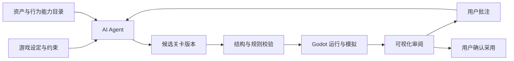

# GunForge 关卡设计引擎与可视化审阅工具方案

版本：v0.3 · 2026-11-08 · 状态：设计基线；用户后续已授权全自动实施。

执行现状见 [状态记录](../gunforge/level_design/reviews/execution_state.json)；正文的讨论、未实施说明保留为写作时的历史边界，不代替当前执行状态。

本版吸收 [v0.1 评审](REVIEW_LEVEL_DESIGN_ENGINE_PLAN.md) 与 [v0.2 复审](REVIEW_LEVEL_DESIGN_ENGINE_PLAN_v0.2.md)，处理说明见第 13、14 节；执行拆分见 [任务文档](LEVEL_DESIGN_ENGINE_TASKS.md)（待用户 review）。**目标是跨游戏的光枪关卡设计引擎；《纸灯城》只是首个生产验证项目。**

## 1. 目标与已确认边界

目标是让 AI Agent 根据游戏设定，产出可执行、可检查、可回放的关卡；用户通过可视化工具查看、播放、批注，再让 Agent 修改，反复迭代到满意。

2026-11-08 用户已确认：

1. 第一版生产落地采用《纸灯城》的 **2D 定点站位关卡**。可试玩的光枪战斗样例从玩家所在位置正面取景，通过近大远小、攻击朝向和玩家受击反馈表达距离。2026-11-08 用户进一步强调关卡语义、Agent、校验与审阅需要跨游戏复用。首版用不同规则包的白模验证通用性，3D 渲染、踏板和双枪执行适配后置。
2. 可视化工具第一版 **只查看、播放和批注，关卡全部由 AI 修改**。可调整播放时间、玩家/调试叠加层与检查缩放；不改变游戏镜头来验收原本不可见的目标，不拖拽修改怪物、事件或参数。
3. AI 修改产生 **可预览的新版本，用户确认后采用**。自动校验通过不等于用户认可。
4. 当前先确认需求、编写方案；本轮不实现引擎或工具。

引擎的交付单位应是一份完整的“关卡演出与交互说明”，包含时间、条件、空间、行为、判定、叙事、声音、画面、资源和恢复规则。单独的出怪时间表不足以表达这些要求。

## 2. 当前项目能复用什么，缺什么

依据：`framework/main.gd`、`framework/core/`、`games/g01/scripts/alley_rules.gd`、`alley_scene.gd`、`levels/alley_0b.json`、`pipeline/build_0b.py`、`pipeline/qa_0b.py` 和 0B 报告。

已有基础：

- Godot 4.6.3 / Compatibility；独立白框、暗区、内容限亮与坐标映射。
- 鼠标、手机 HTTP/UDP 输入、失锁门控、校准与显示配置。
- 可见 alpha 命中、前景挡枪、保护区、弱点和有限辅助吸附。
- 纸偶骨架和附件、点灯、居民净墨、六发弹匣、拾取、续关和结算。
- 本机调试接口可冻结、单步、注入输入、输出状态与截图。

目前的限制：

- `alley_0b.json` 只描述三轮时间和少数数值；怪物位置、居民动画切换、灯区域、声音和 HUD 逻辑仍散落在代码中。
- `alley_scene.gd` 的墨鸦中心、居民位置、灯罩区域和运动公式写死。增加关卡不能只换 JSON。
- `build_0b.py` 的公平性判断是首站专用的顺序威胁检查，尚不能处理通用并发任务和事件分支。
- 现有机器人是功能验证脚本，不是经过玩家数据标定的难度评估器。
- 没有统一事件图、行为库、资源能力清单、版本审阅和批注闭环。

迁移必须保留当前 Demo 作为对照。已有实现不能仅因名称位于 core 就视为已实现完整通用引擎。

迁移的已知差异集中在下一节登记；A1a 保留旧行为，A1b 才按决议逐项修复，A1c 再迁移为通用规则包。

### 2.1 迁移差异与缺陷登记（代码核对，未做实机复现）

迁移先记录来源、现状、目标、证据级别及处理状态；不是把所有现状原样复制。如下编号供基准及验收引用：

- D01 点灯：设定 6 秒，Demo JSON 为 8 秒。**待用户决定**正式数值；旧基准保留 8 秒。
- D02 重复救援：`alley_rules.gd` 对 resident_ink 没有已救援守卫；`puppet.gd` 对 rescue_ink 始终标 primary；获救 clip 的 meta.attachment_keys 在 0–0.2 秒仍显示墨，射击间隔 0.15 秒。存在重复加 300 分/重启动画的代码路径，尚未实机复现。**建议作为缺陷修复**：A1b 先用调试接口复现，再修复并验证逻辑任务只完成一次，表现残留不可再次奖励；不在 A1a 混入修复，若无法复现，保留证据并重新评估具体路径。
- D03 续灯刷分：每次打灯都加 25 分并重置时间。**待用户决定**是否允许续灯、何时有奖励；通用引擎提供可重复交互与一次性/周期性奖励策略，由规则包配置。
- D04 槽位与尺寸：bible 离线候选固定 200px、中心 (420,350)/(1110,350)，运行代码使用约 (1320,550) 与 264px。**待坐标换算和视觉核对**，不把候选直接当正式运行事实。
- D05 预警：warning_contract 光环半径 17–26 内容像素，运行绘制 22–30。**待核对后决定**，都记录于来源映射。
- D06 隐含关卡内容：道具按 wave%2、灯罩墨按 wave%3、获救动作按 2.3 秒切换，而素材获救 clip duration 为 2.2 秒。**迁移为显式实例/cue**，动作结束优先绑定真实结束事件；变更差异需说明。
- D07 续关：当前分数清零、当前波重开。**待用户决定**正式评分及可刷奖励边界。
- D08 纸身误伤：设定和 gameplay_constraints 要求只扣分；`alley_rules.gd` protected 分支还调用 damage，当前会扣灯芯。**建议在 A1b 复现并修复为 g01 规则契约**，先录旧行为，再记录生命不再减少的预期差异；本轮未修改代码。
- D09 时长：level 的 duration=78 是作者标注的目标时长（24×3 + 1.5×2 + 3 秒收束），不是运行完成的墙钟时长；暂停/等待不应混算。
- D10 软化权威：当前 scene 采样 spill 决定 primary/invalid，rules.light_active 另有未用定义。**迁移必须合并为单一逻辑判断**。可继续使用已冻结贴图采样作为逻辑输入，但纯计算不得依赖一次实际绘制，渲染不能反过来决定玩法。

旧版基准专门记录 D02/D08 等已知问题，以证明修复前后的差异；新实现不以复刻缺陷为通过条件。D01/D03/D04/D05/D07 在启用相应正式规则前需解决，不能因旧测试通过就自动放行。

## 3. 从街机机制提炼通用需求

详细来源、公开机制和推论移至 [街机调研附录](ARCADE_LIGHTGUN_LEVEL_RESEARCH.md)。补充核验了 Deadstorm Pirates 的联合射击/舵轮事件、Operation GHOST 的扫描/团队指令及 GoldStorm Pirates 的主线后隐藏关，说明引擎不能把所有关卡都简化为“定时出怪直到清空”。这些并不意味着首版支持相应硬件。

本方案归纳的设计原则是：空间呈现决定识别与瞄准，威胁窗口制造决策，资源限制建立取舍，任务变化避免重复，叙事与音画 cue 指导注意力，成功/失败/路线选择改变后续内容。必须把这些意图记录为可检查的关系，而不只是增减怪物数量。该归纳是设计推论，不是商业游戏内部算法披露。

首版能力分为三类，以下均为计划、非现有实现：

- **需真实执行并验收**：实体/组件、出现和移动、预警及攻击窗口、可见命中区、保护对象、射击/装填/拾取、状态依赖、成功/超时分支、任务合流、音画 cue、评分与检查点、候选版本和批注。
- **结构契约与最小示例，暂不承诺生产执行**：复杂多阶段 Boss、连锁传播、多个可选择站位、范围/连射武器、协作任务与复杂表现轨道（基础动画/音效 cue 属首版运行能力）。可登记依赖或导入设计意图；能力未实现时不能编译为可玩关卡。
- **执行不在首版**：3D 轨道/世界射线、踏板、舵轮、双枪协作、体感输出与在线动态生成。核心保留语义输入与输出接口，不能把这些机制静默替换成单发点击。

通用性不能仅凭“字段可扩展”宣称达成；第 10、11 节规定第二、第三种规则配置的可运行验收。

## 4. 系统结构与唯一数据源

建议采用“设定约束 + 能力目录 + 关卡文档 + 编译/检查 + Godot 运行与预览 + 审阅版本库”。



关键约定：审阅工具展示与游戏运行使用同一个编译产物。工具不另写一套浏览器命中和战斗逻辑。先用 Godot 预览、调试叠加、聊天批注和独立候选包跑通闭环；完整工具形态不预先锁定网页。闭环后做有明确成本上限的原型，比较 Godot 内审阅 UI 与本地网页 + Godot 桥接；核对时间跳转、状态同步、批注定位、差异查看和部署后再选择。若选网页，仍由 Godot 负责渲染与判定。

纯网页渲染可作为轻量概览，但必须标明“示意”，不能当真实 alpha 遮挡、动画和音画同步验收证据。视频导出可分享，不能代替可操作预览。

### 4.1 四层边界

1. **通用关卡核心**：有类型的状态/变量、实体/组件、任务、事件依赖、时间域、威胁窗口、结果、资源、规则效果、评分、检查点、cue、确定性记录与版本。不得引用 g01、墨、纸、灯或具体角色名；不得写按游戏 ID 分支。
2. **设备与表现适配**：输入能力声明（点射、按住/释放、方向/踏板等）、坐标/射线、布局、命中几何、可见性、渲染及声音输出。首版交付 2D alpha + 鼠标/TVGun；1920×1080 白框及 1776×936 内容区属于 TVGun 配置，不是所有游戏的硬编码画布。
3. **游戏规则包**：将通用操作组合成具体含义，提供设定约束、模板、校验扩展、资产绑定、数值和字幕。例如灯是 activation source，软化是状态/受击许可，救援是任务完成，墨线是依赖传播，笔顺是有序部件目标。常规组合用声明式数据，确需新能力时用版本化插件。
4. **关卡内容包**：引用规则包、布局与资源版本，描述具体实例、时间、目标、分支和演出。不复制引擎，也不把每只怪物行为写为独立脚本。

组件采用明确类型，如 pose/motion、target zones、attack、resource、objective、interaction、presentation binding；组件依赖与互斥由能力目录声明。效果只使用已实现的类型化操作（改变状态/资源、产生事件、创建/移除实体、启停行为、切换目标许可、播放 cue），条件读取有类型的状态、事件和 §4.3 的逻辑空间派生值。集合条件、并发/顺序任务、重复次数和等待均有界，拒绝任意 eval 或隐藏脚本。

同一 NPC 可以是保护对象，也可以在别的游戏成为敌人，这由规则包的角色/阵营/关系决定。**《纸灯城》禁止人物攻击玩家和受伤的规则只在 g01 生效**，不应阻止其他题材中的人形敌人。亮度与白框限制同样由显示/输入适配声明。

插件必须提供参数 schema、能力依赖、状态迁移、序列化、事件/效果接口、确定性要求、可见信息摘要、检查器和审阅元数据。审阅工具根据这些元数据展示参数与状态，禁止每款游戏新增一套专用审阅页面。跨 2D/3D 的 position/visibility/raycast 通过适配接口承接，不强行把世界米数当内容像素。

### 4.2 对现有 bible 的引用

现有 bible 是 g01 规则包的来源，不复制成第三套“通用设定”：

- `gameplay_constraints.json`：角色、保护区、误伤与可用动作约束。
- `warning_contract.json`：预警表现及适用对象。
- `animation_contract.json`：可用动画、附件、命中遮罩与相关契约。
- `prototype_slot_schedule.json`：离线候选槽位、尺寸与互斥条件；尚未正式成为运行约束。
- `material_contract.json`、`luminance_policy.json`：站点材质和亮度特例。

规则包清单引用源文件及内容哈希；编译时解析并记录来源。规范冲突需按现状登记逐项解决，不以“最近修改”自动覆盖审批；离线候选槽位先换算到同一坐标系，再决定启用为硬约束还是继续候选。校验器读取启用后的权威契约，不能把标为 pending 的候选直接升级为用户已批准规则。

### 4.3 空间查询与派生状态

核心定义类型化查询契约，2D/未来 3D 适配实现几何算法；规则包声明查询源、实体/区域 ID、坐标空间、采样位置/形状、阈值来源、求值阶段和算法版本。查询结果带 tick、pose_id、坐标单位及 source map，进入轨迹，工具可解释原始值与条件结果。查询是纯函数，不得依赖 GPU readback、绘制是否发生或临时随机数。

查询分两个用途：

- **玩法查询**：基于当前模拟 tick 的逻辑姿态 LogicPose 计算区域包含、冻结遮罩采样、同空间距离/重叠等，再生成派生状态。条件消费同 tick 已定义阶段的值，不使用“最近画出的姿态”决定软化/触发，避免 30/144Hz 改变玩法。
- **命中与审阅查询**：以输入绑定的 RenderSubmission 对应姿态查询可见目标、alpha、辅助范围和遮挡；只把几何证据送入当前逻辑裁决，不回写历史世界状态。审阅需要同时显示历史几何和当前许可的差异。

每 tick 的玩法查询在已存在实体当前姿态与空间源参数确定后、处理输入前求值；某个动作改变空间源（g01 示例：点灯）时，源的逻辑强度/渐变按规则更新，在下一确定的查询阶段生效，不在同 tick 无限求值。源渐变速率、阈值穿越 tick 和同 tick 多枪结果通过 A1a 基准冻结，不能在通用化时暗改。启用依赖循环必须报错或显式加一 tick 延迟。

首批运行查询：区域包含、冻结遮罩的确定性采样、二维距离。g01 用遮罩采样值 × 逻辑源强度与配置阈值比较；靶场用“进入有效区域”触发计时。A1a 先搬出已有采样，不先发明查询语言；A1c 才注册为通用查询操作。

后续启用精确形状重叠、可见面积比例时，要明确分母（原主区/裁切后主区）、alpha 阈值、前景遮挡次序、采样分辨率与插值方法。AABB 只能作粗筛，不能假装 alpha 真值。跨坐标系先经注册变换；单位不兼容、资源无哈希或方法未实现时拒绝编译。复杂可辨识性指标仍为启发式。着色器形变若改变可打轮廓，必须有同版本逻辑 mask/变换，不能由视觉变形后仍用旧轮廓。

### 4.4 会话外壳、HUD 与运行接口

通用外壳提供生命周期（ready/running/paused/result/closed）、暂停原因集合、输入所有权、菜单/结果显示和检查点请求。游戏规则包提供标题/台词、开始条件、是否有生命/续关、续关收费/免费、结果字段和 HUD 配置；不要求所有游戏都经历 continue 或具有生命。玩法内阶段（g01 的 gap/transition 等）是规则包状态，不与外壳生命周期重复定义。设备连接/校准/白框由设备适配负责；暂停期间网络检测继续，模拟计时按暂停策略处理。

正式运行契约需覆盖：加载锁定包；注入标准输入；固定一步；读取只读公共状态/事件/空间查询结果；生成 LogicPose；通知提交姿态；导出/恢复快照；重试/退出/释放资源。HUD 只读声明的 public state，不直接读取 model.lives/ammo 或修改剧情；未知字段明确报错。现有 `tick/command/snapshot/user_paused` 是 g01 隐含接口，A1c 迁移时用适配桥替代，不能要求新游戏伪造旧字段。

调试叠加属于通用审阅服务 + 几何适配，绘制实际 alpha/保护区/辅助边界及输入所用姿态；选中项能显示判定链。现有 F1 已核实存在，但它在 g01 中只画 AABB 与状态文字。A2 将入口接到通用叠加；AABB 保留为明确标注的性能粗筛模式，不作为命中解释真值。HUD 外观可扩展表现模板，不因每款游戏不同而复制整套外壳或审阅界面。

## 5. 关卡内容模型

### 5.0 核心词汇与设计意图

正文核心模型用以下语义；本作词汇仅作为带 `g01` 命名空间的别名/资源绑定，不成为内置字段：

- `target.neutralized` / 目标解除威胁 → g01 净墨（别名 `g01.ink.purified`）。
- `activation_source` / 激活源 → g01 灯；其空间影响通过查询表达。
- `damage_permission` / 受击许可 → g01 软化/硬化；不默认所有游戏都有硬化。
- `protected_zone` / 保护区 → g01 纸身；保护后果由规则包配置。
- `objective.completed` / 任务完成 → g01 居民获救（别名 `g01.resident.rescued`）。
- `presentation.envelope` / 表现渐变 → g01 灯光强度与净化淡出。
- `resource` / 资源 → g01 光、灯芯；其他包可以不用生命或弹匣。

这些名称仍是契约草案，A1c 与两个实际包一起冻结。别名映射只发布一次权威事件，记录 alias/source，不重复结算任务和奖励；Agent 普通改关不自创核心事件。

#### 设计意图、节奏与注意力预算

每个段落先声明玩家要理解/完成的动作、情绪强度、预计耗时范围、必需/可选目标，以及与前后段的变化。Agent 先在宏观层安排介绍—练习—变体—压力—恢复—高潮，再编排具体时空事件；这是可替换的设计模板，不要求每个游戏遵循同一种节奏。

记录同屏可辨识目标、有效威胁、优先目标、必须转移的瞄点、必需射击与装填动作、语音/字幕占用、重要特效遮挡。威胁调度器可以限制并发和错峰预警，但推迟攻击必须同时调整明确的截止/任务依赖并写日志，不能暗中改变设计时序。脚本化精确演出可关闭动态调度，并由校验指出冲突。

Agent 的泛化输入包括题材/基调、玩家任务动词、设备能力、已有机制与资源、时长与难度、允许的失败后果。不能预设每款游戏都有怪物、生命、弹匣、弱点或人质；机制模板由当前规则包选择，未选的系统不产生隐藏默认行为。

### 5.1 层级与身份

建议层级：游戏 → 章节/关卡 → 站点 → 段落/遭遇 → 波次/任务 → 实体与事件。

每项有稳定 ID、中文名称、用途说明、版本和来源。通用层的 station 表示 shot/encounter space，不要求每个游戏必须有纸景式站点；波次也不是所有任务的必需层级。事件、批注、运行日志都引用 ID，不靠数组下标定位。实例与模板分开：修改一个墨鸦实例不能悄悄改变所有墨鸦。

关卡总时长分开显示：作者标注的目标时长、无输入路径时长、某次实际运行时长。等待玩家的条件节点可能延长总时长。

### 5.2 空间与光枪的打击范围

“打击范围”至少分六项，不能只有一个 radius：

1. 屏幕可射区由设备/布局适配声明。TVGun 示例：规范框 1920×1080，默认内容区 1776×936；白边/暗区/离屏行为沿用该适配的坐标契约，不固化为通用分辨率。
2. 对象可见区：图层、槽位、位置、缩放、运动轨迹、前景遮挡、视差与状态变化。
3. 目标区域：主可作用区、弱点、保护区、无效区、遮挡物和可交互区。与绑定姿态的 alpha/mask 及变换一致。g01 示例：墨身对应主区、纸身对应保护区。
4. 武器作用方式：点射、以后可选的范围/散射、穿透层数、伤害与作用对象过滤。首版点射；其他模式没有实现时不允许 Agent 使用。
5. 辅助命中：半径、唯一目标条件、保护区与前景阻断；安全默认不产生弱点奖励、不跨保护/遮挡区。具体策略由规则包声明；g01 禁止穿纸净墨。
6. 实际设备可达性：显示配置、距离、校准误差、有效目标尺寸、目标间距和转移瞄准时间。屏幕空间只是像素距离，若没有显示尺寸/观看距离，就不伪报人体转枪角度。

工具应能分别显示这些区域，解释某一枪为何命中、失效或误伤；支持显示命中辅助前后的结果。《纸灯城》的初始尺寸依据是 GUNFORGE_PLAN §4.4 的主区有效半径至少 40 规范像素（直径至少 80）；GAME01 §5.3 的墨蝌蚪头部直径 90–130。是否适用于某类目标需按原规则范围核对，不能推广为所有游戏的统一阈值；各规则包与设备档案各自声明并真机校准。

### 5.3 时间与事件图

同时支持绝对站点时间、相对事件延迟、条件触发和状态持续区间。例如“第 3 秒出怪”“灯点亮后 0.5 秒起飞”“两只墨怪净化后居民获救”“超过截止时间执行失败分支”。

作者数据以整数毫秒表示时间，界面显示秒；内部建议使用整数 tick（初始 60Hz，待原型确认），固定 seed。编译时对出现时间向上取整，截止的最后允许 tick 向下取整；相对时间先在毫秒域累加到绝对时刻，再统一量化，不能逐段取整。运行时依赖输入的触发，起点取权威事件的 tick 时刻（用有理毫秒精确表示），链内保留未量化到期时刻，再在执行边界量化；逻辑步骤/状态依赖显式设置下一 tick 最早生效屏障。每条 source map 记录声明时刻、实际 tick 与偏差，窗口缩为零时报错，不悄悄扩大窗口。外部输入按记录的 tick、会话和顺序回放，不能只存鼠标坐标。逻辑时间与墙钟时间分开：暂停/失锁不能让战斗截止计时继续流逝。

术语与姿态绑定协议：

- **LogicPose**：固定 tick 发布的逻辑姿态，编号为 session_generation + tick + pose_revision；包含只读变换、形状/遮罩引用与区域元数据。逻辑每 tick 生成，不意味着已经画到屏幕。
- **RenderSubmission**：渲染帧实际提交的记录，含 submission_id、对应 pose_id、模拟 tick、PC 单调提交时刻。144Hz 可以重复提交同一姿态，30Hz 可以跳过姿态；不是显示器曝光时间。
- **InputBinding**：输入入队时主线程原子捕获最近已提交 submission_id/pose_id；网络线程只投递接收数据，不读取场景。射击不得随消费 tick 换绑。尚无提交姿态时拒绝射击并给出原因。
- **SubmissionSchedule**：无窗口运行使用的虚拟提交序列，和真实会话保存的提交序列采用同一语义；可重放重复/跳过的姿态。固定逻辑与此序列共同定义命中回放输入。

姿态缓冲不是无限回溯。首版默认不做额外延迟回溯，仍需保留在途输入绑定、快照重放和渲染管线引用的姿态。容量/最长滞留由设备测量与队列上限决定，并记录配置。被在途输入引用的姿态不得无声淘汰；容量不足或姿态过期按显式拒绝原因处理，不退回当前几何、不产生命中/耗弹等副作用。回溯若日后开启，还需增加相应历史长度及屏障检查。完整历史可落盘供回放，不要求全部常驻。

每个条件节点必须声明：触发次数、有效窗口、前置条件、成功边、超时边、取消条件及站点退出时的清理。依赖等待不能无限挂起，明确进入失败、跳过、重试或人工继续。

时钟至少区分固定模拟 tick、站点/段落局部时间、展示帧和 PC 单调接收时间。输入入队时保留接收顺序、会话、序号、目标 tick、InputBinding 的 submission_id/pose_id，必要时保留源样本标识；不比较手机和 PC 的绝对时钟。

命中不直接使用本 tick 新更新而尚未发布的位置。首版建议以输入入队时 InputBinding 锁定的 RenderSubmission 所引用的 LogicPose 取几何，同时以当前逻辑检查目标仍可受击。该快照只是显示近似，GPU 队列、电视延迟和网络使其不等于玩家真实看到的帧；不宣称已解决端到端延迟。首版交互目标按逻辑发布姿态绘制，不做仅画面移动的插值；以后若要插值，必须提交同样插值后的目标几何快照，不能画一处、判另一处。

裁决顺序建议：输入门控 → 按已捕获姿态做几何查询 → 按当前状态应用有效命中/资源/打断 → 本 tick 截止伤害 → 任务和条件事件 → 推进运动/行为并发布新的 LogicPose（渲染稍后选择并记录 RenderSubmission）。到达截止 tick 的有效枪优先；新生成对象须发布后才可受击。多人/多枪未来按记录顺序裁决，一次性目标只完成一次。

不自动启用固定 90ms 回溯：手机已做瞄点预测，不能再凭网络时钟猜测显示延迟。延迟回溯需设备校准、可用时间证据、显式上限及单独验证；历史几何不能复活已经净化/过期/退出场景的目标，也不能越过 LOST/会话屏障。

固定逻辑确定性与依赖展示的命中回放分别验收：基础模拟使用指定 SubmissionSchedule；实际会话回放必须保存输入所用姿态快照/RenderSubmission 序列，不能期望不同帧率的现场瞄准产生相同命中。30/60/144Hz 下相同 seed + 输入 + SubmissionSchedule 应有一致逻辑轨迹；实际发布节奏变化的差异由记录解释。

边界用例包含：目标在两 tick 间移出准星、渲染提交滞后、多个输入共享一帧、命中与截止同 tick、已净化目标被重复命中、LOST 后迟到射击、回溯上限与跨阶段禁用。以上是待技术原型验证的协议，不是当前代码已具备的能力。

### 5.4 敌人行为、攻击与 Boss

行为用带参数的模板和状态机表达：出现 → 可辨识 → 预警 → 攻击准备 → 攻击 → 恢复/退出；任意允许阶段都可响应命中、打断、净化和取消。

实例配置包含：模板版本、槽位/轨迹、尺寸、状态、目标区域、耐久/命中要求、预警、攻击间隔、作用效果、截止、可拦截投射物、受击许可条件、打断条件和解除威胁结果。g01 将这些绑定为净化次数、硬化/软化和墨消散。

区分装饰群体与有效威胁；并发攻击由调度器限制。攻击模式可以轮换、序列或受 seed 控制的权重选择，每种选择都有可检验边界。

Boss 是多个阶段与可射部件的组合：阶段进入条件、部件顺序、弱点窗口、攻击序列、阶段转换、失败与复原。例如“忘”字七笔必须显式描述当前可打笔画、提示与误射结果，不能靠图片看起来像字就自动有笔顺规则。

《纸灯城》规则做成游戏扩展：点灯软化、独立附墨清除、墨线连锁、笔顺。本作 NPC 本体始终不能成为攻击玩家的敌人；其他游戏由其角色关系定义。

### 5.5 任务、剧情与镜头

支持解除威胁计数、保护/救援任务、拦截、激活交互、存活、顺序部件、限时/限资源和到达事件等目标。g01 示例：解除威胁是净墨，激活交互是点灯。必需目标与加分目标分开。

剧情节点记录说话人、台词 ID、语音、字幕、触发条件、是否阻断战斗、跳过结果和持久故事变量。跳过不能让关卡缺少必要状态；语音实际长度变化要使依赖 cue 重新检查。

站点间镜头/转场应声明时长、输入屏蔽、预加载、结束状态。进入镜头不允许敌人在看不清之前开始攻击。完整 3D 轨道和自由移动不在首版。

### 5.6 道具、武器、得分与恢复

每项道具记录：生成条件、位置、寿命、获取方式（射击/自动/完成目标）、是否耗弹、作用、上限、重复获取、持续/冷却、失败与续关处理。自动使用还是主动使用是能力配置；当前单枪输入无法支持的新操作必须先有明确 UI 入口。

资源操作必须守恒且可追溯；普通换弹、补弹、生命恢复、特殊攻击不能混用语义。任务完成、拾取与奖励结算须由逻辑状态保证一次性/幂等，不能靠动画隐藏保证。任务完成后的装饰残留不再触发该任务和奖励；后续可否作用于对象由规则包决定。g01 示例：获救墨继续消散但不可重复计分，获救纸身不再触发误伤。

关卡声明评分项、弱点奖励、连击窗口、误伤扣分、结算字段和检查点。失败可重试当前段；续关恢复生命、弹药、敌人、道具、灯和剧情变量的规则需逐项明确，避免刷奖励。分数重置列入第 2 节差异登记，未经决定不把 Demo 的清零策略升为正式规则。

### 5.7 动画、特效与声音

动画绑定 clip ID、开始条件、循环、混合/切换、结束事件、附件层级和命中区随动。事件完成依赖 clip 的明确结束 cue，不能假设每个获救动作都长 2.3 秒。

特效声明层级、锚点、粒子/贴图、时长、遮挡、亮度、是否覆盖目标和性能预算。装饰烟雾不能在可受伤时完全盖住必打目标。

声音分音乐、环境、预警、武器、命中、角色语音与 UI。记录 asset ID、触发、空间/屏幕位置、循环、优先级、并发上限、混音组、淡入淡出及语音压低音乐规则。声音丢失不能使必需预警不可理解；配视觉提示。

动画、特效和音效以语义事件绑定，如 `attack.warning`、`target.neutralized`、`objective.completed`；g01 可绑定为 `g01.ink.purified` / `g01.resident.rescued` 别名，避免每关复制整段播放代码。事件日志能追溯“为什么此时播放这段声音”。

### 5.8 资源与能力目录

目录列出当前真正可用的站点、槽位、角色、敌人模板、动画、特效、音频、字幕、交互和动作，带版本、哈希、许可状态及约束。

AI 可提出新资源需求，但不能编造资源 ID。缺资源时在候选版中列出需求单；白模/占位音可预览，但必须标明缺失，不能标为可正式发布。修改关卡与生成新素材分为不同任务，是否生成及费用需按已有授权另行处理。

## 6. 数据格式与执行边界

建议第一版的关卡源数据以 **JSON 为唯一可编辑源格式，JSON Schema 校验**，避免 YAML 与 JSON 双源漂移；AI、运行器与审阅工具读同一结构。中文名称和设计说明作为字段保留。YAML 导入/导出可后置，取代早期总体方案中先 YAML 再编译的设想；这是待确认建议；仅适用于关卡数据，不要求改写已有 YAML 骨架、素材或审核记录。

文件建议拆为 `level.json`（段落/站点引用）、`stations/*.json`、`encounters/*.json`、`behaviors/*.json`、`cues/*.json`，每项稳定 ID。拆文件按职责，不按每次生成的随机片段拆碎。

下面只是字段关系草图，不是已发布 schema，也不是当前 Demo 可以直接加载的数据：

```json
{
  "schema_version": "draft-3",
  "id": "sample.gallery",
  "basis": {"ruleset_ref": "sample.targets@1", "capability_revision": "pinned"},
  "clock": {"tick_hz": 60, "seed": 421},
  "layout_ref": "sample.room_2d",
  "entities": {
    "target_01": {"template_ref": "sample.moving_target", "slot_ref": "right_mid"}
  },
  "events": {
    "spawn_01": {"trigger": {"at_ms": 3000}, "action": {"type": "spawn", "entity_ref": "target_01"}}
  },
  "objectives": {
    "clear_01": {"type": "count_event", "event": "target.neutralized", "entity_ref": "target_01", "count": 1}
  },
  "outcomes": {
    "success": {"when_objective": "clear_01", "next": "complete"},
    "timeout": {"at_ms": 10000, "next": "retry_segment"}
  }
}
```

需要稳定定位的集合以 ID 为键；显式顺序用独立的 ID 顺序列表或 order 字段，不以数组下标作为持久补丁地址。源时间使用毫秒，编译产物/source map 保存 tick 及量化规则版本。整个包版本定义为规范化相对路径 + 文件内容哈希组成的排序清单哈希；规则、适配、资源与编译器版本在清单中锁定。跨文件补丁原子应用，不能一半成功。

原始数据先经引用解析、单位/类型检查、能力检查和事件编译，输出冻结的运行包及 source map（运行事件到作者字段的映射）。未知动作、缺失引用、非法循环、未定义目标或不支持的武器行为直接阻止构建。

新机制不能让 AI 在关卡里塞任意 GDScript。普通修改只改变已支持的数据；需要新程序能力时先生成“能力缺口说明”，经需求确认后再开发插件。扩展的输入、输出、状态序列化与确定性都需遵守公共接口。

## 7. AI Agent 的设计与修改流程

### 7.1 输入与产物

输入：已确认设定、玩法硬约束、当前关卡、可用资源/行为、设备与难度档案、用户目标、带定位的批注、已有试玩记录。

产物不只是 JSON，还包含：关卡意图与情绪曲线、教学安排、候选关卡、资源缺口、变更摘要、受影响对象、验证结果与待确认项。

### 7.2 工作步骤

1. 提取本次目标与不能改变的约束，读取锁定版本和资源目录。
2. 先设计段落意图，例如“认识灯 → 安全练习 → 同屏权衡 → 奖励救援”。
3. 选择现有机制模板，安排站位、可见性、弹药与攻击窗口，再编排音画。
4. 生成结构化补丁，限定在指定对象/段落；支持新增、删除、修改和批量参数调整。
5. 在临时候选版本应用，跑结构、引用、事件可达性与规则检查。
6. 进行确定性模拟、截图和分支回放，失败则有限次修正；无法解决时报告具体冲突和替代方案。
7. 输出候选预览、差异和“已验证/仍待体验”的说明，等待用户采用或继续批注。

可以由一个 Agent 分步骤执行；不要求多 Agent，模型供应商和执行入口不写死在关卡格式里。首版可由当前聊天中的 Agent 读取批注包并提交候选，是否要工具内一键调用 Agent 仍待确认。

### 7.3 补丁、并发与采用

补丁必须携带 base revision/hash，校验旧值或字段路径；若关卡已变，不覆盖新内容，重新生成或提示冲突。可采用 JSON Patch 的 test/add/remove/replace；如 `/events/spawn_01/trigger/at_ms`，直接按稳定键定位。base revision 是整个多文件包的清单哈希；先对临时完整包校验再发布，冲突不写回原包。

候选是不可变快照，状态建议为 draft → checked → previewed → accepted / rejected / superseded。用户采用只原子切换当前版本指针；旧版、批注和运行证据都保留，可回退。自动校验不得自行写 accepted。

版本存储约定（目标布局，不是当前已实现能力）：

- 规范入口是小型采用指针，如 `gunforge/level_design/adopted/<package_id>.json`；它引用不可变源包清单哈希，不维护另一份可编辑“当前源”。Git 工作区的最新文件不自动等于当前采用版本。
- 候选的 JSON/规则定义/锁文件等小型源文件存于 `gunforge/level_design/packages/<package_id>/revisions/<revision>/` 并入 Git。Agent 只新增候选、批注答复和变更说明，不直接修改采用指针；可基于显式指定的候选分支继续迭代，但必须标明基线，默认 base revision 指向采用版本。
- 大型媒体沿用现有审核资产路径/LFS 或内容寻址库；候选只引用冻结哈希。编译产物、截图/短片、逐帧轨迹放外部构建/证据目录，不新增进 Git；源版本与小型证据索引入库，索引含证据位置/哈希/生成配置。现有历史报告不因本约定被删除。
- 用户采用形成一次可追溯的 Git 提交，持久记录候选源（若尚未提交）、采用指针和采用理由/警告确认；不复制候选覆盖固定源文件。仅处理本次明确路径，不能打包其他未提交工作；失败保留原指针。旧版本可由 Git 源和锁定工具/资产重建，外部视觉证据另行备份；证据缺失明确报告，不能声称可重建完全相同的硬件观察。
- 源清单哈希不包含状态索引、自身清单文件或 Git 提交 ID，防止循环。编译包 ID 由源 revision 与锁定编译器/引擎/适配版本共同生成；采用与回放证据同时记录两个 ID。候选运行路径按 build ID 隔离，不覆盖唯一 `framework/runtime/`。

审阅日志与运行事实是追加记录，previewed 等状态可由日志派生；accepted 必须有用户明确采用记录及相应持久化结果，不能由 Agent 预览动作推导。具体 Git 事务与崩溃恢复在版本任务中验证。

`previewed` 只在用户启动该版本且首帧成功呈现后由查看器记录，并保留会话；它不表示已检查所有路径，更不表示已采用。校验重跑生成新的验证记录，不修改不可变候选。

视觉工具只保存批注和采用动作，不直接修改设计数据。用户的“节奏快一点”需由 Agent 转成具体变更，并在摘要说明缩短了什么、为何这样做，以及是否改变难度。

## 8. 可视化审阅工具

### 8.1 核心视图

- 总览：关卡树、站点顺序、分支、教学目标、预计/实际时长与待审版本。
- 画面：真实 Godot 场景；可开关前景、槽位、轨迹、命中区、保护区、弱点、当前威胁与空间源影响范围（g01 示例：光照遮罩）。
- 时间轴：角色/敌人、攻击预警、伤害窗口、镜头、剧情、空间源/表现参数、道具、动画、特效、语音、音乐分轨；点击定位到事件及属性。
- 事件图：前置条件、成功/失败/超时边及分支合流；选定路径后生成对应时间轴。条件事件未发生前显示相对窗口，不伪造绝对时间。
- 属性与解释：只读查看对象所有参数、模板继承、解析后的实际值、来源文件和当前状态。
- 检查与轨迹：错误定位、每枪判定、事件触发链、资源变化、威胁曲线、模拟结果。
- 版本对照：新增/删除对象、时间与参数差异、受影响的台词/资源/路径、同 seed 和同输入下的前后画面。

没有真实资源或检查数据的面板明确标明尚未实现/未测，不用虚构数值填满界面。

### 8.2 播放与时间跳转

支持播放/暂停、逐帧、倍速、跳至事件、循环某段、从检查点开始、无输入演示、脚本机器人和鼠标/光枪试玩。观察模式能隐藏调试覆盖，检查真实玩家能看见什么。

向后拖动不能仅设置 clock：必须从初始状态或最近快照恢复，然后重放输入和事件到指定 tick。快照包含实体、行为、随机数及算法版本、输入队列/去重状态、事件与定时器、资源、任务、检查点、剧情、动画片段/局部时间/附件、镜头与晃动相位、表现渐变量/空间源强度、提示计时、拾取状态和已发布命中姿态；持续音轨的游标/混音状态单独重建。音频跳转时重建持续声，历史一次性声音不补播，正常正向运行仍完整播放。

建议每 1 秒及阶段边界建快照；90 秒测试包任意跳转 P95 ≤0.3 秒、无窗口模拟 ≥10 倍实时均为原型目标，需注明机器、资源和数据量，不是已测承诺。逻辑轨迹哈希必须完全一致；同平台/适配版本的确定性截图可逐像素比较，GPU/驱动变化的画面对比按遮罩/几何与声明的容差，音频按 cue 和时间位置检查，不要求跨设备位级一致。

同一时刻可能因不同玩家输入得到不同世界状态；界面显示当前路径、seed、输入记录与版本。没有输入的跳转只是某条指定演示路径。

### 8.3 批注闭环

批注可锚定“版本 + 站点 + 段落 + tick/时间区间 + 对象/事件 ID + 画面区域”；同时保存截图、当前路径和必要状态。支持文字、严重程度、期望结果和不可改变项。

例如：`v12 / alley / 12.4–14.0s / crow_02`：“墨鸦挡住居民胸口，救援目标看不清；保留同时出场，调整位置。” Agent 应优先移动墨鸦/调整轨迹，不能通过删除居民来关闭问题。

批注最小字段为 comment_id、package_revision、站点/段落、时间区间（毫秒并显示秒）、对象/事件 ID、画面区域及坐标系、文字、严重程度、期望结果、不可改变项、截图/状态记录路径、路径与 seed；无法锚定的字段明确为空。

每个候选自动提供证据包：关键事件/批注时刻的干净截图与命中叠加截图、必要的短片/音频、逐 tick 轨迹、规则检查、参数差异及源映射。Agent 必须实际读取相应图像和检查输出后自检，不能只读 JSON 就声称视觉已修复。逐步加入可见面积、救援区遮挡比例、目标间距、并发威胁、空档、尺寸和亮度指标；注明算法版本和阈值来源，指标不取代用户体验。

批注状态：待处理、需澄清、已提交候选、待用户复核、已解决、暂不处理。Agent 只能标记已提交候选，不能替用户认定视觉问题已解决。旧版本批注在新版映射失败时显示“需重新定位”，不自动绑到同位置的新对象。

推荐界面布局：左侧关卡树，中间场景，下方多轨时间轴，右侧只读属性/批注；另有事件图和版本对照页。第一版不提供设计拖拽手柄、参数输入框或节点连线编辑。

## 9. 校验、仿真与难度

### 9.1 结构错误、硬约束与启发式结果

确定性结构错误阻止编译：缺引用、错误类型/单位、无界即时循环、必需目标可静态证明不可达、等待无超时、无效检查点、缺必需能力、保护区被登记为可伤害。游戏包显式硬约束也阻止编译，例如 g01 中人物为攻击者；其他游戏的人形敌人不受此限制。

启发式的可辨识性、公平性、不可避免伤害推断为高严重度警告，允许候选构建/预览，并提交具体路径和证据；采用前需用户逐条确认或修订。不能仅因 Agent 自评通过就关闭警告。静态规则可以证明的遮挡/窗口违规与推测的人类识别困难分别标注。

缺素材但绑定了显式占位资源时，可生成标注为 placeholder 的设计预览；缺关键行为实现则只能看静态意图，不能运行相关分支。正式发布检查拒绝占位物，不混同“设计候选可采用”与“正式游戏可发布”。

### 9.2 公平性要同时考虑空间与动作成本

对每个伤害窗口，检查目标从“玩家能辨认并开始处理”到攻击生效的时间；计入反应、目标转移、每目标射击次数、冷却、装填、离屏/回屏、先激活机关等前置操作（g01 示例：点灯）。

检查满弹、仅余一发、空弹、临近状态到期、多目标并发、保护对象遮挡、低生命和失锁恢复等边界。不能把目标出现在数据中当作玩家已经看见；alpha、对比、遮挡、动画、镜头与提示共同决定可辨识时刻。

采用可配置动作模型，早期总方案中的 0.4 秒反应、0.25 秒转移只能作为未标定起点。当前 build_0b.py 的检查是 `.4+.15+.3+.5+.5+.25+.15 = 2.25` 秒；代码没有逐项命名，不能把推测的解释当原作者契约。迁移时将其替换为明确的 reaction、aim_transfer、shots/cooldown、activation_delay、reload、offscreen_return 等具名参数，逐项说明来源，不能直接沿用七项常量作为通用难度模型。首版用保守的窗口/约束检查加状态搜索找出冲突；复杂几何和人类辨识仍需要实际渲染与试玩，不能宣称数学证明了所有情况可解。

### 9.3 机器人与检查结果

先有确定性功能机器人验证“事件能完成、失败能恢复”；再加入只看玩家可见信息、带瞄准误差和反应时间的难度机器人。禁止借隐藏对象真坐标提前瞄准。

输出：成功/失败路径、伤害来源、有效射击/命中、弱点、误伤、装填、道具、救援、超时、威胁并发、事件空档、时长和性能。多 seed/不同水平输出样本量及分布，不能用一次通关证明难度合理。

将结果分为错误、警告、设计建议、未测和人工已确认。机器人通过不自动通过美术、手感和真实光枪追踪。

## 10. 《纸灯城》落地样例与机制范围

建议用现有巷口素材先做一个 60–90 秒候选关卡，时序为讨论示例，尚未替换当前 Demo：

1. 安全观察：居民出现，突出胸腹墨与纸身的边界；没有攻击截止。
2. 净墨练习：一次独立救援，成功后播放感谢并给明确反馈；超时走帮助提示。
3. 点灯教学：出现硬化墨鸦，提示点灯；点亮后进入可伤害窗口。
4. 练习组合：居民与墨鸦同时出现但命中区分离；玩家安排净墨、射击与换弹。
5. 奖励与休息：补光或灯芯，允许处理余下可选目标。
6. 收束：完成目标后转场；失败可重试当前段，不重播全部教学。

**首版闭环必须有**：可变出怪时序和位置、点灯依赖、预警/攻击/净化、独立救援保护区、换弹和拾取、至少一条成功/超时分支、动画音画 cue、暂停/失锁/恢复、批注、新版对比和采用。

**后续逐步补齐**：更多运动/投射物模板、墨线连锁、多阶段 Boss 与笔顺、复杂路线、更多道具与武器、完整章节剧情。第一版可登记这些资源需求，但不假装行为已可运行。

**暂不进入**：3D 轨道、自由移动、双枪协作、踏板、在线多人、在线自适应 AI 实时编关。游戏运行时执行冻结关卡，不依赖大模型在线响应；自动难度调节若启用，需要单独制定规则。

### 10.1 必须通过的跨游戏白模验收

除巷口生产样例，增加不使用《纸灯城》资源和词汇的两个小包，均保持首版 2D 定点适配：

- **抽象靶场**：静止/横移目标、正确/错误类别、限弹、时间窗、命中数量与误击结果；可设为无敌人攻击、无生命、只有得分的规则，证明引擎不强制“怪物—灯芯—救援”。最小样例在 A2 就须运行并由 Agent 修改。
- **科幻拦截/保护**：攻击无人机、可打断投射物、不可误击的运输目标、护盾开关及保护成功/失败合流；使用不同弹匣/资源与奖励规则。C 阶段启用对应模板后运行，不能仅展示 JSON 就算通过。

另做不执行的覆盖走查：双站位掩体、舵轮 QTE、双人联合射击、连续射击/炮击切换、顺序部件 Boss、主线后可选关。每项明确需要哪些核心语义、规则组件、输入和表现适配；缺能力明确拒绝，不把它改造成纸灯机制。该走查验证架构覆盖，不冒充已运行复用。

验收红线：加载不同包时公共核心和审阅 UI 无游戏 ID 分支；标准组合只改数据；第二包能编译、运行、回放、显示目标、生成批注及候选；第三包随相关模板完成真实同链路验证；新语义通过插件注册，不偷偷往核心写特例。两种白模仅证明所覆盖的通用机制，不代表所有街机玩法均已支持。

## 11. 分阶段实施与验收（任务 review 后另行授权）

具体任务、依赖、交付路径、证据与初估见 [任务文档](LEVEL_DESIGN_ENGINE_TASKS.md)。阶段只描述验收边界，不能跨阶段混合修改后一次性宣称等价。

### A0：隔离录制旧基准与差异决议

先固定旧实现版本、未提交差异、资源/构建与环境哈希，再录基准，不能先改运行循环。仅增加录制控制/观测时，另存最小插桩补丁与 hash，证明未改变玩法语义。关闭鼠标/键盘、UDP、HTTP 实时玩法入口，只允许专用录制控制器注入；必要的连接/锁定状态由受控记录驱动。冻结不等于输入隔离。

录制完整有序的 freeze、step(frames)、input、锁定/模式控制、状态读取、画面刷新/提交和 capture 序列。关键边界用 step=1；D02 可记录累计 9 帧约 0.15 秒的间隔及第二枪，不把一次 step(600) 等同逐帧提交。保存注入时绑定几何对应的刷新记录，执行两次确认无实时污染。

用例含正常通关、漏打、误伤、装填、失锁恢复、续关、重复救援与续灯。复现失败也保留输入和证据，不能先修复后补“旧失败”。差异决议分类为保留/修复/参数待定。

### A1a：只做确定性地基，不改关卡模型

保留现有 g01 规则与素材结构，只改固定步长、输入排队、LogicPose/RenderSubmission/InputBinding、命中几何与绘制分离、D10 软化搬到等价逻辑函数、轨迹与快照基础。新的会话外壳、声明式机制与数据化不混入本阶段；D02/D08 先保留为旧行为。

与 A0 按同序列和提交计划比较事件/公共状态；仅允许事先登记的边界 ±1 tick，分数、生命、命中结果不可任意容差。D10 用相同贴图、阈值、渐变、变换与采样定义验证。额外确定性验收：相同包、seed、输入和 SubmissionSchedule 无窗口三次轨迹一致；30/60/144Hz 只改变外部渲染频率时逻辑不变。未通过先定位本阶段，不继续用通用化掩盖差异。

### A1b：独立修复已决定的缺陷

D02/D08 先复现再修，每项一个独立变更和一组预期轨迹差异；D01/D03/D07 只有用户选择后才改变参数/策略。D04/D05 先完成技术核对再记录决议。未决定的项保留为明确的 migration_legacy 配置，不能当作正式已验收关卡，但不应阻断无关靶场的开发。

验收：已修项失败/正常边界均覆盖；旧基准与新结果的差异只出现在登记允许的事件和状态；无关用例不变。产出固定步长的“修正后 g01 行为基准”，供 A1c 精确对照。

### A1c：最小通用核心、规则包与第二样例

依据 g01 与靶场的真实需求冻结最小 schema：ID 键集合、源毫秒量化、空间派生状态、输入/效果、任务/事件、会话外壳/HUD 公共接口、bible 引用及包清单。将 g01 迁移为规则包，同时使抽象靶场真正可编译、运行。A2 开始前不能只留第二包的 JSON。

验收：g01 的公共行为轨迹与 A1b 逐 tick 精确一致，不再容许时序偏移。比较统一规范化记录（状态/资源/事件/命中/任务/空间值/姿态），保留 source map；两种内部数据结构的私有序列化哈希不要求相同。私有快照自身的重复运行确定性另测。异题材包无 g01 生命周期/生命字段依赖；核心无游戏 ID 分支；未知能力明确拒绝。

### A2：隔离候选与最小 AI 审阅闭环

Agent 只写候选源、生成独立运行包与证据；直接用 Godot 及通用 alpha 调试层预览；在聊天里按版本/时间/对象批注。按 Git 源版本与采用指针契约确认/回退；先实际完成两三轮，不等待完整 UI。至少一轮在靶场包进行。

验收：指定修改局限在预期对象/字段；旧采用版继续可启动；不覆盖唯一 runtime；冲突/采用中断安全；图像和命中解释真实对应绑定姿态。用户据两三轮结果决定进入 B 还是先补机制，Agent 不自动扩大范围。

### B：选择审阅形态并完善工具

按任务文档设定短原型预算，比较 Godot 内 UI 与网页桥接；用同一包、同一批注/跳转用例评估，选定后只建设一条正式实现。完善关卡树、时间轴、事件图、只读属性、版本对照、快照跳转和批注。

验收：同一运行产物，不另写战斗模型；任意事件可定位到来源与原因；两个规则包不改工具代码均可查看；逻辑/画面/声音及跳转性能按 §8.2 验证。超过原型预算仍未解决的桥接问题提交备选决议，不能同时维护两个完整查看器。

### C：机制扩充、第三样例和真机验收

启用运动/投射物、空间重叠/可见性检查与复合任务；完成保护/拦截白模同链路验收，补三包自动验证与真机光枪测试。复杂 Boss/连锁作为独立后续批次，首版不因范围走查全部变成必做实现。

验收：三包均通过设计—编译—运行—回放—审阅—候选流程；难度估计注明标定与样本；玩家体验与硬件追踪保留人工验收。未通过真实 0B 不自动启动有该前置的批量美术。无窗口速度、跳转指标是原型目标，未达成需说明瓶颈/取舍并由用户决定下一阶段。

## 12. 待确认项与阻塞关系

已确认：通用关卡引擎目标；首版生产验证采用 2D 定点《纸灯城》；工具只审阅与批注；AI 修改生成候选、用户采用。

### A0/A1a 的技术决议与后续规则决议

- **验收范围**：建议巷口旧基准 + 异题材靶场白模，第三种保护/拦截白模在机制扩充时完成。无新正式美术投入。
- **A1a 前的技术契约**：固定步长初值 60Hz、姿态绑定/历史保留、轨迹字段与时序容差需由技术原型决议固定；JSON ID 键集合与源毫秒量化在 A1c 冻结。不需要用户逐个选工程参数，但不得把未验证的建议写成已实现事实。
- **A1b 的规则决议**：D02/D08 建议先复现再修；D01/D03/D07 的灯时长、续灯与奖励、续关评分需用户选择。D04/D05 是技术/视觉核对，不能把坐标未核实的问题转嫁为用户数值选择。未决项保留显式 legacy，不改变原语义，不阻塞无关公共能力；正式 g01 验收前必须解决。

### A2 闭环或 B 工具前确定，不阻塞 A0 设计

- Agent 是从当前聊天处理批注，还是工具内直接发起；建议先聊天闭环。
- 是否必须同一窗口；Godot 内界面还是网页，由对照原型和实际审阅痛点决定。
- 缺资源能否用清晰标注的白模/占位音；建议可以设计预览，但正式发布拒绝占位资源。
- 首个正式关卡的剧情推进、目标失败分支、难度档案与连锁/Boss 深度。建议先标准难度，逐项增加能力。

### 长期通用性边界

Agent 负责章节到逐事件的设计层级是建议；玩家人数、生命/弹药制、场景比例、角色阵营、任务时限、音画风格属于规则包和适配配置，不冻结为《纸灯城》的数值。暂不实施的机制必须同时标明“设计表达/编译/运行/审阅/验证”各层支持状态，避免仅预留字段就宣传全类型支持。

仍为需求讨论稿。本轮只修改文档，没有实施引擎、修改游戏规则或批准批量制作。

## 13. Review 处理结果

- R01 **采纳并补足**：A0 先录旧基准，A1 单列确定性基础、输入队列、几何与绘制分离、逻辑层权威；帧率独立验收明确所用 SubmissionSchedule。
- R02 **部分采纳、修正判定**：接收输入时捕获发布姿态，区分它与真实显示帧；首版交互对象不做仅视觉插值。固定延迟回溯不默认启用，也不能声称手机时间可直接对齐 PC。见 §5.3。
- R03 **采纳**：迁移前冻结接口录基准，事件对齐容差与已知缺陷变更分开。见 A0。
- R04 **采纳**：ID 键对象、源毫秒/编译 tick、全包清单哈希及跨文件原子补丁。示例改为不含 g01 语义的最小自洽包。
- R05 **采纳并加强泛化**：完整 UI 前先验证修改闭环；Godot/网页二选一留给原型。schema 的冻结样本增加异题材白模，不只依据墨鸦 Demo。
- R06 **采纳并补充**：新增 D01–D10；重复救援仍标代码路径推断，增加 review 漏掉的纸身扣生命、真实 clip 时长与软化权威问题。未运行实机复现，不把推断登记为硬件事实。
- R07 **采纳但明确边界**：现有 bible 是 g01 规则包来源；不升级为所有游戏的硬约束，也不自动批准 pending 槽位。
- R08 **采纳**：增加证据包、视觉自检指标、批注最小字段与需澄清状态。
- R09 **采纳并区分发布**：结构/确定性约束阻止编译；启发式公平性允许候选预览但采用需确认；占位预览与正式发布分开。
- R10 **采纳**：源入 Git、候选/运行/证据按哈希隔离、独立采用指针与 previewed 事实记录，禁止覆盖唯一 runtime。
- R11 **采纳**：完整快照状态、性能目标与像素/逻辑/音频验收分开，未标成已测数据。
- R12 **采纳并澄清**：调研移至附录，正文保留机制范围与阻塞关系。复审澄清原意见只建议结构调整，并未主张其他机制无关；v0.2 对其意图的解读不准确，本版修正。泛化验收仍纳入第一条闭环，复杂执行适配后置。

v0.2 时 F1 尚未核实；本次已核对 main.gd 的 KEY_F1 与 alley_scene.gd 的 debug 分支，确认现有入口只显示 AABB。§4.4 已补实际能力与迁移要求。原 review 文档保持原文，供逐条追溯。

## 14. v0.2 复审处理结果（N01–N08）

- N01 **采纳**：A1 拆为 a/b/c，每步只改变一种主要因素；A1c 使用统一公共行为轨迹逐 tick 精确比较，不跨不同实现比较私有状态哈希。
- N02 **采纳并限定求值基准**：§4.3 增加空间派生状态、类型/坐标/算法版本；玩法用 LogicPose，命中用绑定的提交姿态。可见面积等复杂查询分批启用，不把 AABB 当 alpha 真值。
- N03 **采纳**：§5.3 定义四个术语、引用缓冲、入队绑定与虚拟提交计划；不把逻辑发布误当实际显示，不以回溯上限为零推断无需保存姿态。
- N04 **采纳并补事务约定**：小源候选入 Git，派生产物/证据外部存储，采用指针才是规范入口；采用有用户记录和限路径提交，不隐含包含其他未提交修改，不另维护可漂移的当前源副本。
- N05 **采纳**：§5.0 增加核心词汇到 g01 映射，通用章节改中性术语；TVGun 分辨率仅为适配示例，本作别名有命名空间。
- N06 **采纳**：§4.4 写明会话外壳、可配置 HUD 和正式运行接口；F1 已核实，仅是 g01 AABB 入口。A2 迁移到通用叠加与实际 mask。
- N07 **采纳**：A0 录制明确隔离全部实时玩法输入、完整步进/注入/刷新序列、受控锁定状态及插桩边界。
- N08 **采纳**：规模初估、预算与阶段暂停/返工决策点列入任务文档；均非排期承诺，不以“估计时间到了”替代验收。

一致性项：移除 D01 重复段；静态不可达改为“可静态证明”；补相对时间的毫秒域量化；D02 统一先复现再修；A1c 明确抽象靶场编译运行。没有按 review 的“现在可以开始 A0”自动开工，因为用户本轮要求先 review 任务文档。

本轮只做文档核对与任务拆分，未运行基准录制或修改游戏代码。根目录同名 v0.2 review 当前为空，本次采用 docs 目录中的完整文件，两个用户文件均未改动。
